<div align="center">


# Ofox Desktop

### AI ツールをワンクリック接続。管理も創作も、ひとつの場所で。

ツール、セッション、リソース、アシスタント、使用量をひとつのデスクトップアプリに。

[English](README.md) · [简体中文](README.zh-CN.md) · **日本語**

[](#compatibility)
[](#compatibility)
[](#download)
[](LICENSE)

<h3><a href="https://ofox.ai/ja">公式サイト</a> · <a href="https://ofox.ai/ja/desktop">ダウンロード</a> · <a href="https://github.com/ofoxai/ofox-desktop/releases/latest">GitHub Releases</a></h3>

[ワンクリック接続](#quick-start) · [ワークスペースのデモ](#tour) · [機能](#features) · [対応ツール](#compatibility) · [FAQ](#faq)

<picture>
<source media="(prefers-color-scheme: light)" srcset="assets/readme/hero-light.svg">
</picture>
</div>

_ライト・ダーク両方の素材を用意し、表示設定に合わせて切り替えます。_

<a id="quick-start"></a>

## AI ツールが初めてでも、ワンクリック接続から。

1. **Ofox にログイン。** ひとつのアカウントで、選択した対応ツールを接続できます。
2. **使うツールを選択。** Ofox がインストール済みクライアントを検出します。接続したいものを選び、未インストールのツールは利用可能なインストーラーまたは公式配布ページから先にインストールします。
3. **「連携する」を一度クリック。** Ofox が選択したツールごとの専用 API キーを管理し、それぞれの形式で接続設定を書き込みます。結果はツールごとに確認でき、競合や失敗も個別に表示されます。

<picture>
<source media="(prefers-color-scheme: light)" srcset="assets/readme/binding-flow-light.svg">
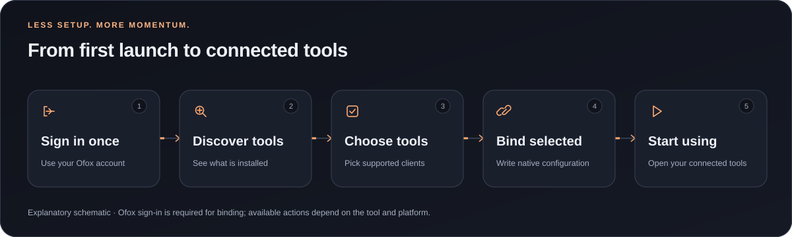
</picture>

### ワンクリック接続のデモを見る

ツールの設定を続ける：[<kbd> MCP を設定 ↗ </kbd>](docs/resource-setup.md#ja-mcp) · [<kbd> Skills を設定 ↗ </kbd>](docs/resource-setup.md#ja-skills)

<picture>
<source media="(prefers-color-scheme: light)" srcset="assets/readme/onboarding-light.gif">
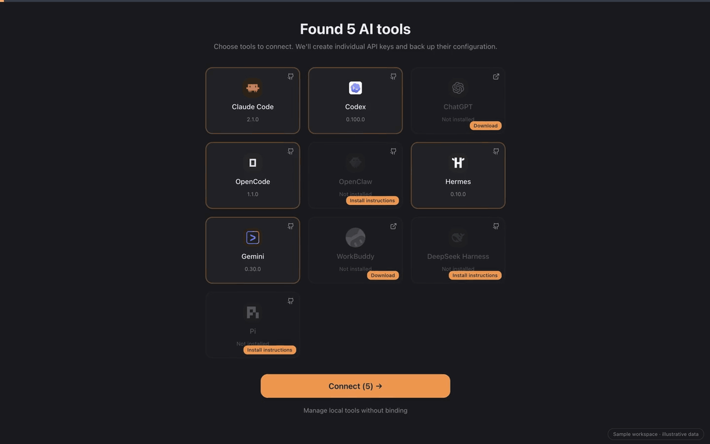
</picture>

**動画を見る:** [ダーク版](assets/readme/onboarding.mp4) · [ライト版](assets/readme/onboarding-light.mp4)

_ワンクリック接続はログインとツール選択の後に実行し、インストール済みの対応クライアントへ設定を書き込みます。すべてのツールの自動インストールや既存セッションの変更を意味しません。デモは架空のデータを使い、実アカウントへのリクエストは行いません。_

ローカル管理だけを使う場合は、接続を設定せずに対応するローカル機能を利用できます。接続済みの外部ツールは設定されたサービスへモデルリクエストを直接送り、Ofox Desktop を閉じた後も保存済み設定を使えます。[接続ライフサイクル](docs/tool-lifecycle.md)をご覧ください。

<a id="tour"></a>

## AI ワークスペースを、ひと目で

<picture>
<source media="(prefers-color-scheme: light)" srcset="assets/readme/tools-ja-light.webp">
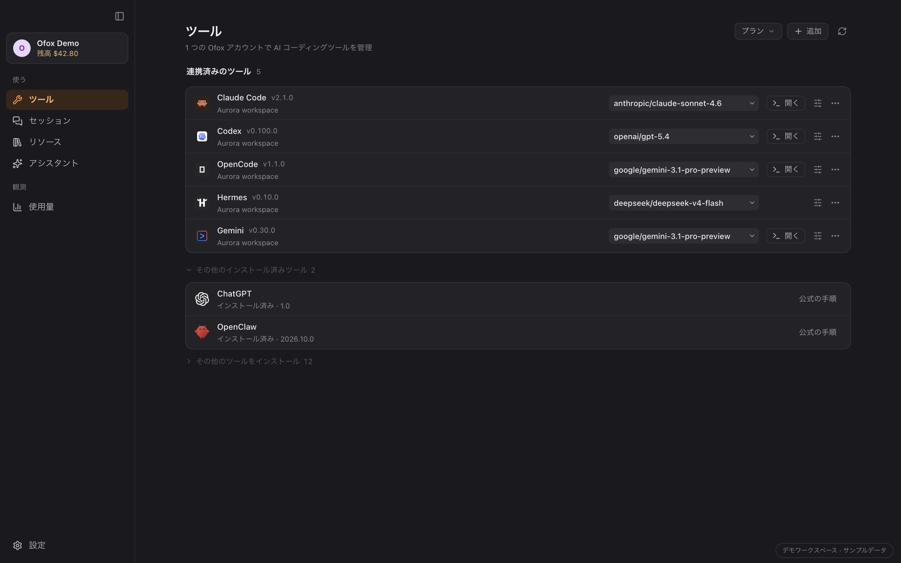
</picture>

インストール済みツールと接続状態を確認し、複数ツールのモデル設定をプレビューできます。インストールと Ofox への接続は別々に管理されます。設定が失われた場合は明示的に復元でき、接続解除の前には変更内容を確認できます。

**ワークスペースの応用動画：** [ダーク版](assets/readme/tour.mp4) · [ライト版](assets/readme/tour-light.mp4)

_スクリーンショットとデモは架空のデータと実際のアプリコンポーネントを使用しています。アシスタントの内容は例示であり、モデル評価や実リクエストの成功を示すものではありません。機能ギャラリーとデモは英語 UI を共用しています。_

<a id="features"></a>

## 5 つの画面で、作業をつなぐ

### ツール：設定にかかる時間を減らす

インストール済みツールを検出し、対応クライアントのインストール、Ofox 接続、モデル選択を管理します。更新は検出したインストール元に合わせて行い、対応しない操作には理由や公式の手動手順を表示します。Ofox が管理する接続先は選択した `ofox.ai` / `ofox.io` リージョンに追従し、ユーザーが編集したアドレスとの競合は明示します。

### アシスタント：質問を、次のアクションに

利用可能なモデルとの対話、ファイル添付、ウェブ検索を行い、会話履歴をローカルに保存できます。会話の分岐、エクスポート、音声入力、読み上げにも対応します。

- **画像生成**：文章からビジュアル素材を作り、同じ会話で制作を続けられます。
- **動画生成**：ワークスペースを離れずに動画制作を始められます。
- **音声生成**：文章を音声に変換し、ナレーションや解説に使えます。

画像・動画・音声の生成には、選択したモデルとアカウントの対応が必要です。形式、権限、料金、利用可否は操作ごとに異なります。

<picture>
<source media="(prefers-color-scheme: light)" srcset="assets/readme/assistant-media-light.svg">
</picture>

<details>
<summary>画像・動画・音声生成の画面を見る</summary>

モデルとパラメーターを選ぶデモ画面です。生成リクエストは送信していません。

**画像生成** — モデル、サイズ、品質、画像数を選びます。

<picture>
<source media="(prefers-color-scheme: light)" srcset="assets/readme/assistant-image-light.webp">
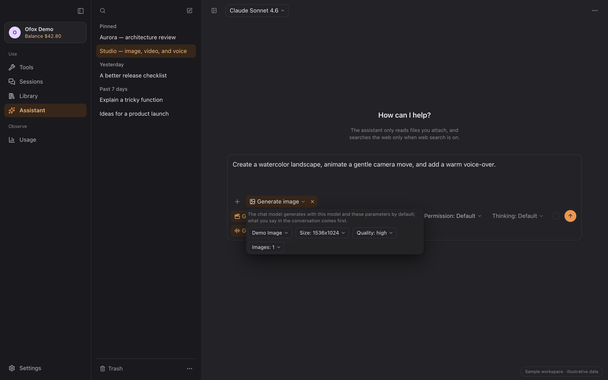
</picture>

**動画生成** — 長さ、解像度、アスペクト比、音声オプションを設定します。

<picture>
<source media="(prefers-color-scheme: light)" srcset="assets/readme/assistant-video-light.webp">
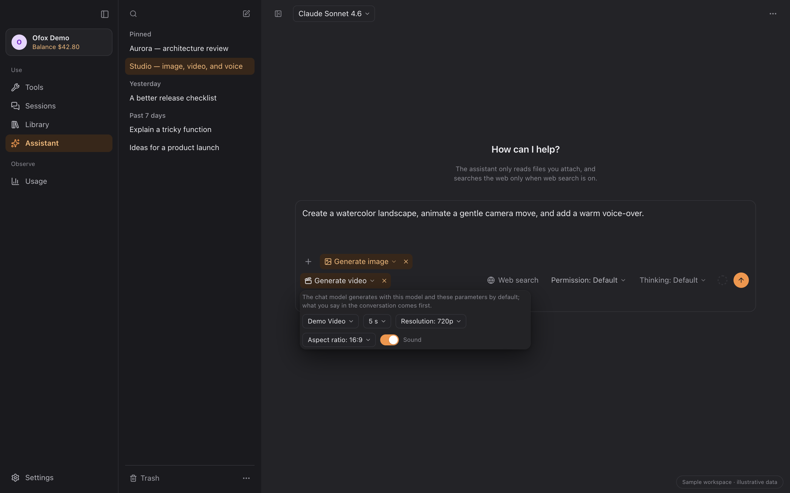
</picture>

**音声生成** — テキストに使う声と出力形式を選びます。

<picture>
<source media="(prefers-color-scheme: light)" srcset="assets/readme/assistant-speech-light.webp">
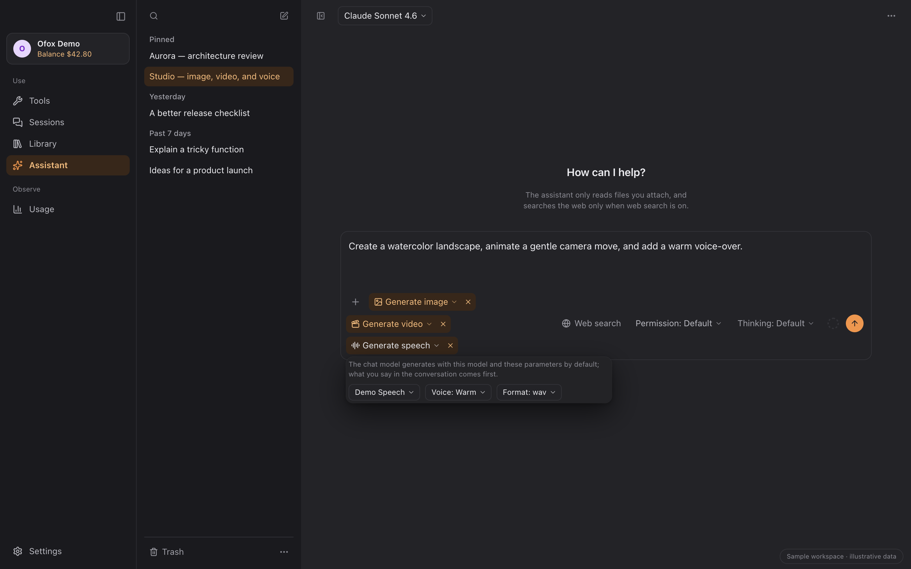
</picture>

</details>

**設定で困ったときも、アシスタントに相談。** 「動かない？アシスタントに相談」をクリックすると、そのツールの診断用会話が開きます。リクエストを送信すると、設定・実行環境・Ofox 接続を調べ、選択した権限に従って変更し、結果を検証します。未解決の問題は明示されます。

<picture>
<source media="(prefers-color-scheme: light)" srcset="assets/readme/configuration-rescue-light.svg">
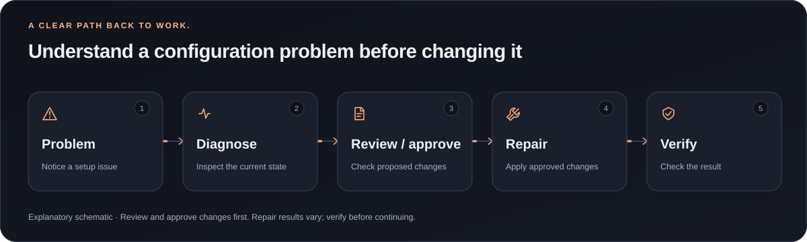
</picture>

<picture>
<source media="(prefers-color-scheme: light)" srcset="assets/readme/assistant-light.webp">
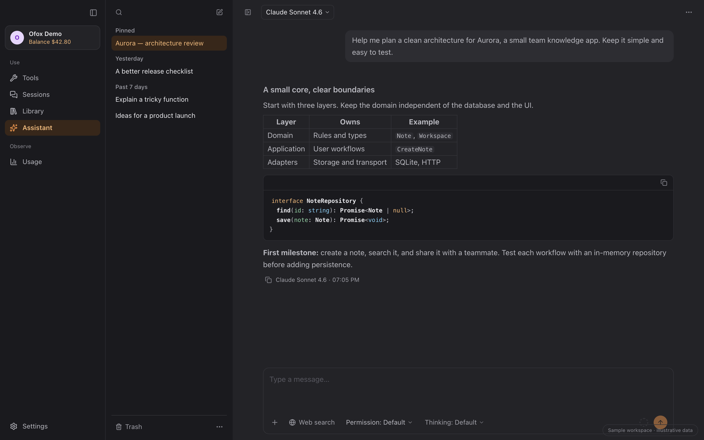
</picture>

### セッション：前の作業から再開

対応ツールのローカル会話をプロジェクト別に閲覧。保存元が対応している操作に応じて、検索、閲覧、エクスポート、再開、復元可能なごみ箱を利用できます。

<picture>
<source media="(prefers-color-scheme: light)" srcset="assets/readme/sessions-light.webp">
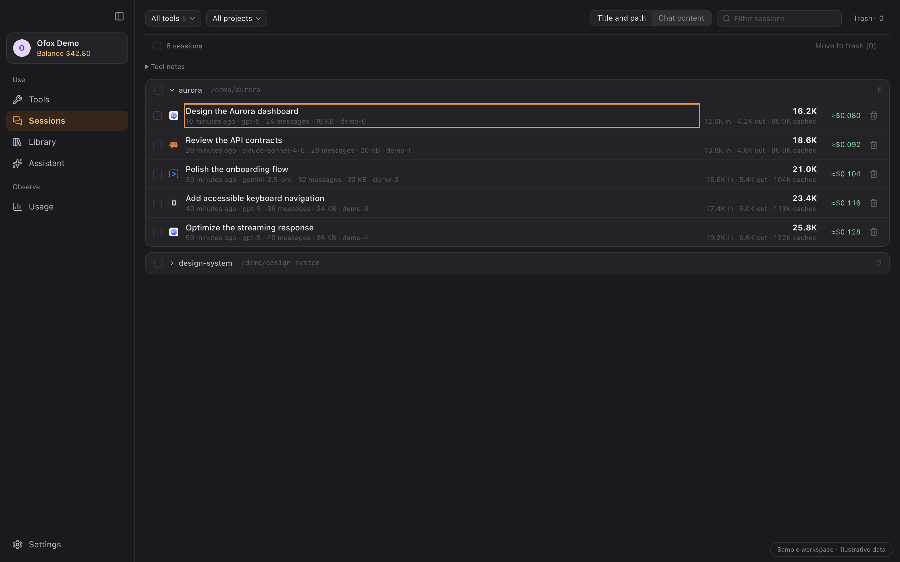
</picture>

元のサイズで見る: [ライト版](assets/readme/sessions-light.webp) · [ダーク版](assets/readme/sessions.webp)

### ライブラリ：まとめて管理し、適用先を選ぶ

指示、MCP サーバー、Skills を一か所に。既存の設定を検出し、差分と配布内容を確認してから、選択したアプリに適用します。

<picture>
<source media="(prefers-color-scheme: light)" srcset="assets/readme/library-light.webp">
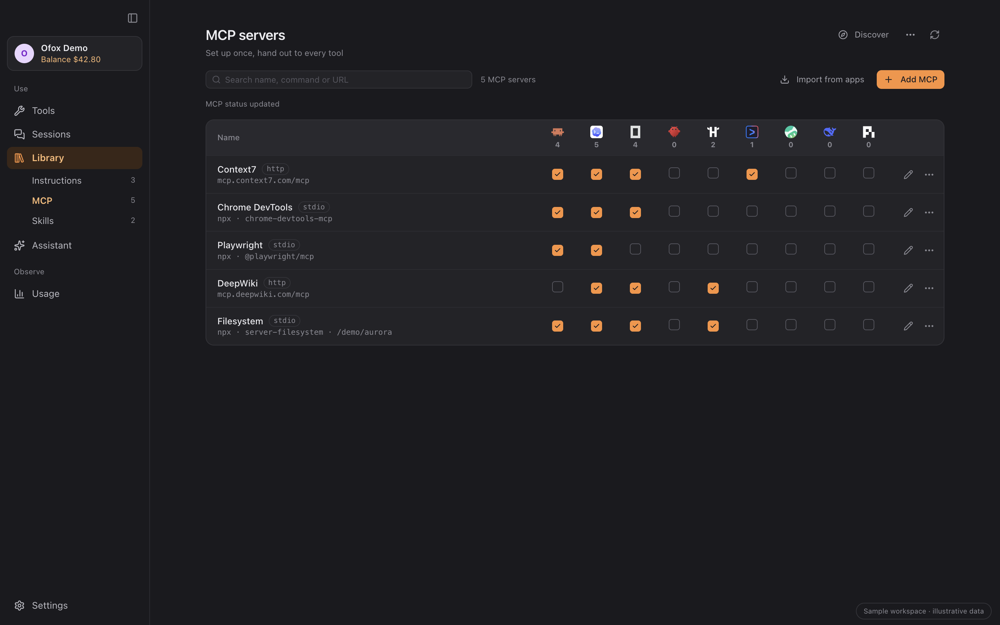
</picture>

元のサイズで見る: [ライト版](assets/readme/library-light.webp) · [ダーク版](assets/readme/library.webp)

### 見つける：次に役立つ機能を探す

厳選された MCP と Skills を閲覧できます。選択は下書きの準備にとどまり、収集、アプリへの適用、接続成功はそれぞれ別の状態として表示されます。

<picture>
<source media="(prefers-color-scheme: light)" srcset="assets/readme/discover-light.webp">
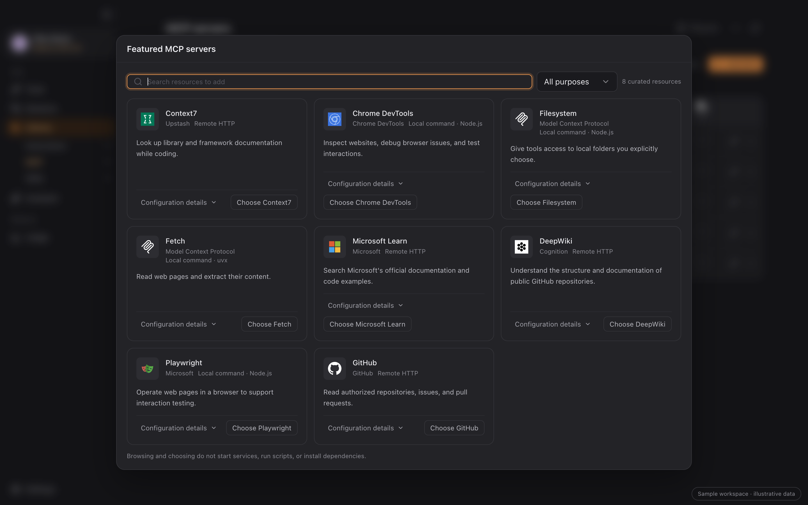
</picture>

元のサイズで見る: [ライト版](assets/readme/discover-light.webp) · [ダーク版](assets/readme/discover.webp)

### 使用量：作業の内訳を知る

ツール、プロジェクト、モデル、日付でローカル記録を確認し、リクエストの詳細閲覧や CSV 出力ができます。記録の範囲や不明な価格を明示し、推定額と請求額を区別します。

<picture>
<source media="(prefers-color-scheme: light)" srcset="assets/readme/usage-light.webp">
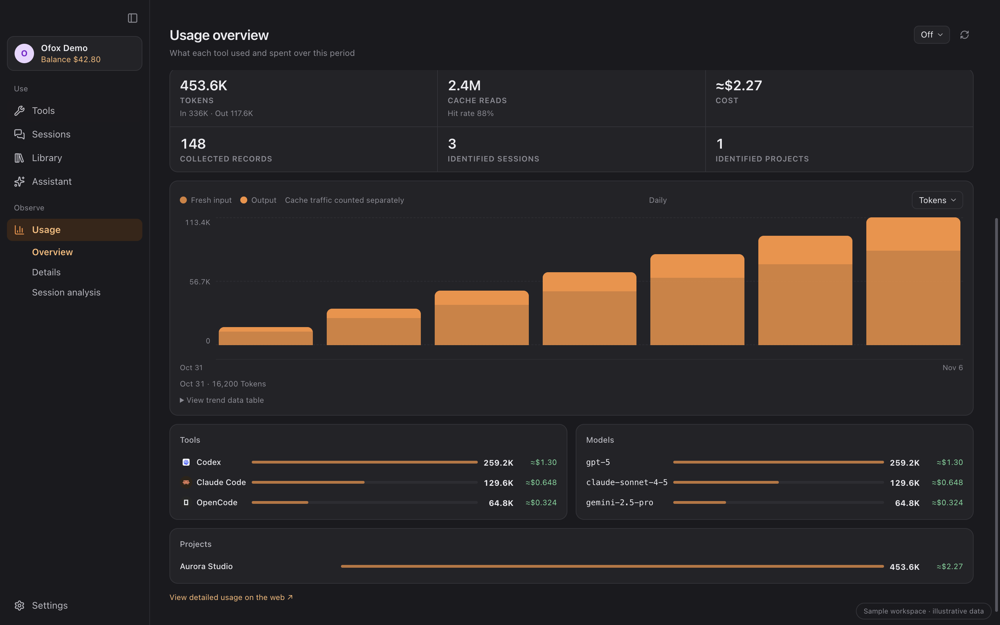
</picture>

元のサイズで見る: [ライト版](assets/readme/usage-light.webp) · [ダーク版](assets/readme/usage.webp)

<a id="compatibility"></a>

## いつものツールと一緒に

<picture>
<source media="(prefers-color-scheme: light)" srcset="assets/readme/tool-wall-light.svg">
</picture>

10 の対応ツールを、ひとつの接続フローで。各ツールで利用できる操作は次の表をご覧ください。

| ツール                  | ワンクリック接続 | インストール／更新     | セッション               | 使用量       | MCP と Skills |
| ----------------------- | ---------------- | ---------------------- | ------------------------ | ------------ | ------------- |
| Claude Code             | ✓                | ✓                      | 閲覧・エクスポート・再開 | ✓            | ✓             |
| Codex                   | ✓                | ✓                      | 閲覧・エクスポート・再開 | ✓            | ✓             |
| ChatGPT（Codex モード） | ✓                | インストール／標準更新 | Codex と共用             | Codex と共用 | ✓             |
| OpenCode                | ✓                | ✓                      | 閲覧・エクスポート・再開 | ✓            | ✓             |
| OpenClaw                | ✓                | ✓                      | 閲覧・エクスポート       | ✓            | ✓             |
| Hermes                  | ✓                | ✓                      | 閲覧・エクスポート       | ✓            | ✓             |
| Gemini CLI              | ✓                | ✓                      | 閲覧・エクスポート・再開 | ✓            | ✓             |
| WorkBuddy               | ✓                | 公式配布／アプリ内更新 | 閲覧・エクスポート       | ✓            | ✓             |
| DeepSeek Harness (dsh)  | ✓                | ✓                      | セッション一覧           | ✓            | ✓             |
| Pi                      | ✓                | ✓                      | 閲覧・エクスポート・再開 | ✓            | ✓             |

**✓ は 1.5.0 で対応済み。** セッション欄には利用できる操作を示しています。

- **インストールと更新：** 自動インストールは Apple Silicon Mac と Windows に対応。CLI の更新は検出したインストール方法に従い、判別できない場合は手動の手順を表示します。ChatGPT は macOS ではアプリ内更新、Windows では winget／Microsoft Store を使用。WorkBuddy は公式配布とアプリ内更新を使用します。
- **ChatGPT と dsh：** ChatGPT の Codex モードは Codex と設定およびローカルのセッション・使用量を共有します。通常の ChatGPT クラウド会話はこの連携の対象外です。dsh は 0.2 以降が必要で、最初に `dsh web` を一度実行して設定を初期化します。セッション一覧はメタデータを表示し、本文閲覧・エクスポート・再開には対応しません。
- **リソース：** MCP と Skills は 10 ツールに対応。指示は Claude Code、Codex、Gemini CLI、OpenCode、Hermes にも対応します。各ツール固有の形式・通信方式に従い、Codex／ChatGPT は同一の物理設定先を共有します。
- **使用量：** ローカル記録を分析し、Ofox アカウントの請求は別に表示します。記録や価格情報の範囲はソースによって異なるため、ローカルの推定値はプロバイダーの完全な請求書とは異なります。

詳細：[設定とデータソース](docs/agent-wiring.md) · [ツールの更新](docs/tool-updates.md) · [リソース対応](docs/library-workbench.md) · [既知の制限](docs/known-limitations.md)。

<a id="download"></a>

## ダウンロード

| OS          | パッケージ                                          | 要件                                                         |
| ----------- | --------------------------------------------------- | ------------------------------------------------------------ |
| **macOS**   | [`.dmg` をダウンロード](https://ofox.ai/ja/desktop) | Apple Silicon、macOS 12+。正式版はコード署名・Apple 公証済み |
| **Windows** | [`.exe` をダウンロード](https://ofox.ai/ja/desktop) | x64、Windows 10/11。NSIS インストーラー、現時点では未署名    |

[GitHub Releases](https://github.com/ofoxai/ofox-desktop/releases/latest) にインストーラーと `SHA256SUMS.txt` があります。Windows SmartScreen に未署名アプリの警告が出た場合は、配布元を確認したうえで「詳細情報 → 実行」を選択してください。各 AI クライアントには別途システム要件があります。

Ofox の設定から更新を確認するか、アプリ内の新バージョン通知をご利用ください。

<a id="faq"></a>

## データと設定について

<picture>
<source media="(prefers-color-scheme: light)" srcset="assets/readme/data-flow-light.svg">
</picture>

<details>
<summary><strong>リクエストはどこに送信されますか？</strong></summary>

外部 AI ツールは、設定されたサービスにモデルリクエストを直接送信します。Ofox Desktop は設定とローカル統計を管理します。Ofox Desktop を閉じても、ツールは保存済み設定を引き続き使用できます。内蔵アシスタントは選択したサービスに独自のリクエストを送信し、任意の検索や MCP 操作はそれぞれのサービスを利用します。

</details>

<details>
<summary><strong>認証情報と設定はどう扱われますか？</strong></summary>

正式版はログイントークンとツールキーのコピーをシステムの資格情報ストアに保存します。開発版のストレージは分離されています。ツールへの接続時には、そのツールが必要とする形式で専用 API キーをローカル設定に書き込みます。変更時は競合を確認して無関係なフィールドを保持します。複数ファイルの操作は一部のみ完了する場合があり、結果を個別に表示します。詳細は[ツール連携](docs/agent-wiring.md)をご覧ください。

</details>

<details>
<summary><strong>使用量が請求額と異なるのはなぜですか？</strong></summary>

ローカル記録にはイベントや価格が欠ける場合があり、Token の記録方式もツールごとに異なります。アカウント請求、保存済み金額、現在の価格による推定額は区別して表示し、収集範囲と不明値を明示します。[使用量の仕様](docs/usage-analytics-contract.md)と[リクエスト画面](docs/usage-requests-alignment.md)をご参照ください。

</details>

<details>
<summary><strong>古い macOS 版から更新する場合は？</strong></summary>

署名証明書が変わると、既存のキーチェーン項目へのアクセスを macOS が再確認することがあります。Ofox Desktop の更新による要求であると確認してから、システムの案内に従い「常に許可」を選択してください。以前拒否した場合は Ofox を終了して再度開いてください。以降の確認は署名とシステムの許可状態によって異なります。

</details>

問題やアイデアは [Issue](https://github.com/ofoxai/ofox-desktop/issues) または [PR](https://github.com/ofoxai/ofox-desktop/pulls) へ。報告と添付ファイルからは認証情報と個人情報を取り除いてください。

フィードバック用メール：[**hi@ofox.ai**](mailto:hi@ofox.ai)。

<a id="development"></a>

## 一緒につくる

<details>
<summary>ソースからのビルドと開発への参加</summary>

Tauri 2 · React 18 · TypeScript · Rust。Node.js 20.19+（20.x）または 22.12+、pnpm 10、Rust stable が必要です。OS ごとの依存関係は [Tauri の前提条件](https://tauri.app/start/prerequisites/)をご覧ください。

```bash
pnpm install --frozen-lockfile
pnpm dev                 # Tauri アプリ全体
pnpm dev:renderer        # renderer のみ、ポート 3011
pnpm build:renderer      # ウェブアセットをビルド
pnpm build               # デスクトップアプリをビルド
```

検証とサンドボックスの規則は [AGENTS.md](AGENTS.md) と[開発基準](docs/code-standards.md)をご確認ください。リリース手順：[リリースゲート](docs/code-standards.md#release-gate)、[リリースワークフロー](.github/workflows/release.yml)、[ブランチ用パッケージ](docs/branch-packages.md)。Windows の動作は Windows 上での検証が必要です。

</details>

<a id="license"></a>

## ライセンスと謝辞

[MIT](LICENSE)。参考プロジェクト：[cc-switch](https://github.com/farion1231/cc-switch) · [magpie](https://github.com/yetone/magpie)。作者とコントリビューターに感謝します。

[出典とライセンスの詳細](docs/acknowledgements.md)
