<div align="center">


# Ofox Desktop

### Connect in one click. Manage and create in one place.

One desktop app for your AI tools, sessions, resources, assistant, and usage.

**English** · [简体中文](README.zh-CN.md) · [日本語](README.ja.md)

[](#compatibility)
[](#compatibility)
[](#download)
[](LICENSE)

<h3><a href="https://ofox.ai/">Website</a> · <a href="https://ofox.ai/desktop">Download</a> · <a href="https://github.com/ofoxai/ofox-desktop/releases/latest">GitHub Releases</a></h3>

[One-click setup](#quick-start) · [Workspace tour](#tour) · [Features](#features) · [Compatibility](#compatibility) · [FAQ](#faq)

<picture>
<source media="(prefers-color-scheme: light)" srcset="assets/readme/hero-light.svg">
</picture>
</div>

_Light and dark previews follow your display preference._

<a id="quick-start"></a>

## New to AI tools? Start with one-click setup.

1. **Sign in to Ofox.** One account connects the supported tools you choose.
2. **Choose your tools.** Ofox detects installed clients. Keep the ones you want; install missing tools first using an available installer or their official download page.
3. **Click “Connect” once.** Ofox manages a dedicated API key for each selected tool and writes its native access configuration. Check the result for each tool; conflicts and failures are shown separately.

<picture>
<source media="(prefers-color-scheme: light)" srcset="assets/readme/binding-flow-light.svg">
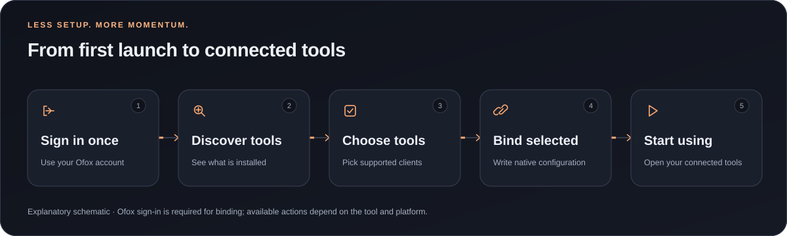
</picture>

### Watch one-click setup

Continue setting up your tools: [<kbd> Configure MCP ↗ </kbd>](docs/resource-setup.md#en-mcp) · [<kbd> Configure Skills ↗ </kbd>](docs/resource-setup.md#en-skills)

<picture>
<source media="(prefers-color-scheme: light)" srcset="assets/readme/onboarding-light.gif">
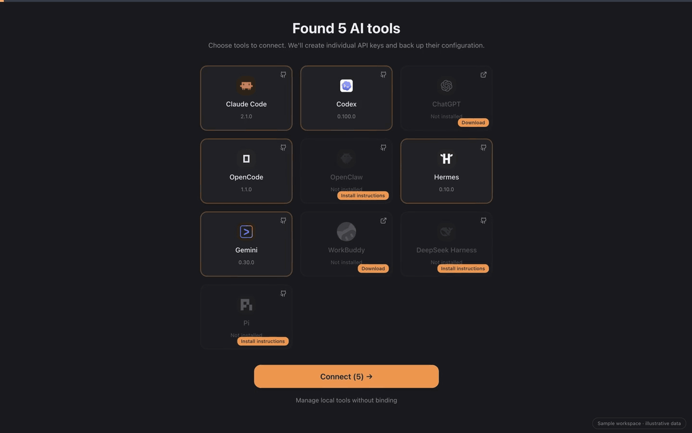
</picture>

**Watch the video:** [Dark](assets/readme/onboarding.mp4) · [Light](assets/readme/onboarding-light.mp4)

_One-click binding starts after sign-in and tool selection. Supported, installed clients receive configuration; this does not install every tool or change every existing session. The demos use fictional data, not live account requests._

Prefer local management? You can enter supported local features without binding. Connected external tools send model requests directly to their configured service and can keep using saved configuration after Ofox Desktop closes. See the [binding lifecycle](docs/tool-lifecycle.md).

<a id="tour"></a>

## Your AI workspace, at a glance

<picture>
<source media="(prefers-color-scheme: light)" srcset="assets/readme/tools-en-light.webp">
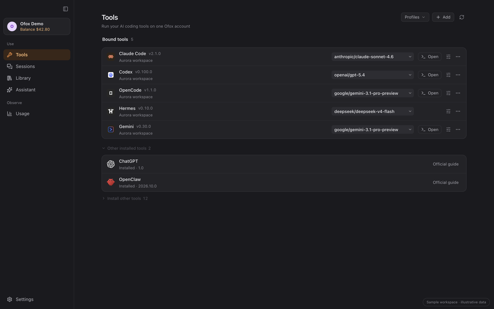
</picture>

Manage installed tools, inspect their connection state, and preview model profiles across tools. Installation and Ofox binding are tracked separately; missing configuration can be restored explicitly, and unbinding starts with a change preview.

**Advanced workspace video:** [Dark](assets/readme/tour.mp4) · [Light](assets/readme/tour-light.mp4)

_Screenshots and the tour use fictional demo data and real application components. Assistant content is illustrative; it is not a model benchmark or proof of a live request._

<a id="features"></a>

## Five places. One workflow.

### Tools — spend less time setting up

Discover installed tools, install supported clients, manage Ofox access, and keep model choices together. Updates follow the detected installation source; unsupported operations show a reason or an official manual route. Ofox-managed endpoints follow your selected `ofox.ai` / `ofox.io` region, with conflicts surfaced for user-edited addresses.

### Assistant — turn questions into your next step

Talk to available models, attach files, use web search, and keep local conversation history. Branch or export conversations, and use voice input or read-aloud.

- **Generate images** — turn a prompt into visual assets in the same conversation.
- **Generate videos** — create clips without leaving your workspace.
- **Generate speech** — turn text into spoken audio for narration and voiceovers.

Image, video, and speech generation require a supporting model and account. Formats, permissions, pricing, and availability vary by operation.

<picture>
<source media="(prefers-color-scheme: light)" srcset="assets/readme/assistant-media-light.svg">
</picture>

<details>
<summary>See image, video, and speech generation controls</summary>

These sample screens show model and parameter selection; no generation request was sent.

**Image generation** — Choose a model, size, quality, and image count.

<picture>
<source media="(prefers-color-scheme: light)" srcset="assets/readme/assistant-image-light.webp">
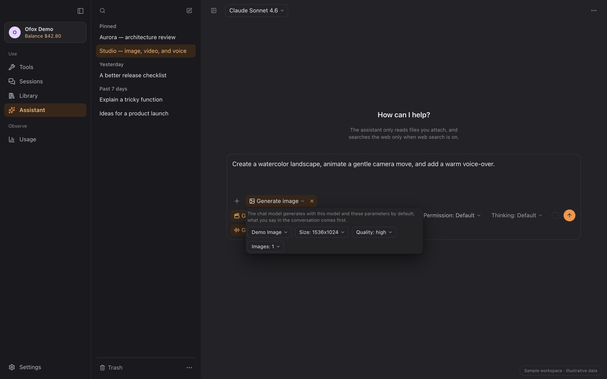
</picture>

**Video generation** — Set the duration, resolution, aspect ratio, and audio options.

<picture>
<source media="(prefers-color-scheme: light)" srcset="assets/readme/assistant-video-light.webp">
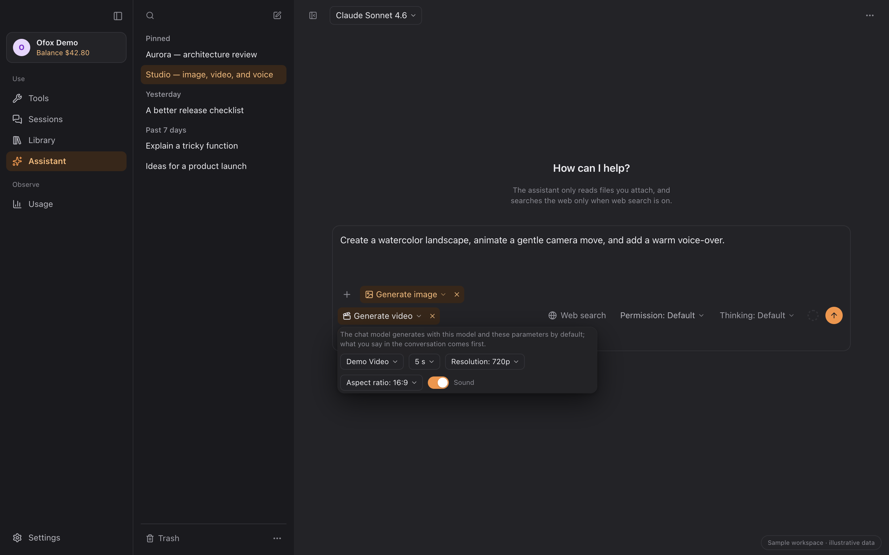
</picture>

**Speech generation** — Choose a voice and output format for your text.

<picture>
<source media="(prefers-color-scheme: light)" srcset="assets/readme/assistant-speech-light.webp">
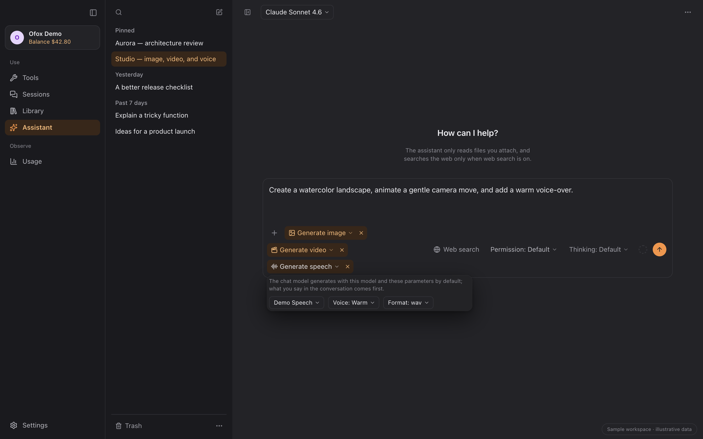
</picture>

</details>

**A fallback when setup goes wrong.** One click on “Not working? Ask the assistant” opens a prepared diagnosis request for that tool. After you send it, the assistant can troubleshoot configuration, environment, and Ofox bindings, make changes under your selected permissions, and verify the result. Unresolved problems remain explicit.

<picture>
<source media="(prefers-color-scheme: light)" srcset="assets/readme/configuration-rescue-light.svg">
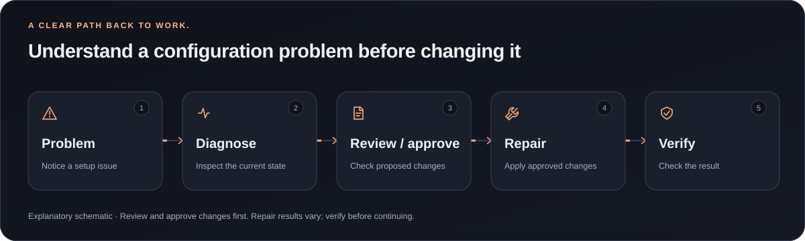
</picture>

<picture>
<source media="(prefers-color-scheme: light)" srcset="assets/readme/assistant-light.webp">
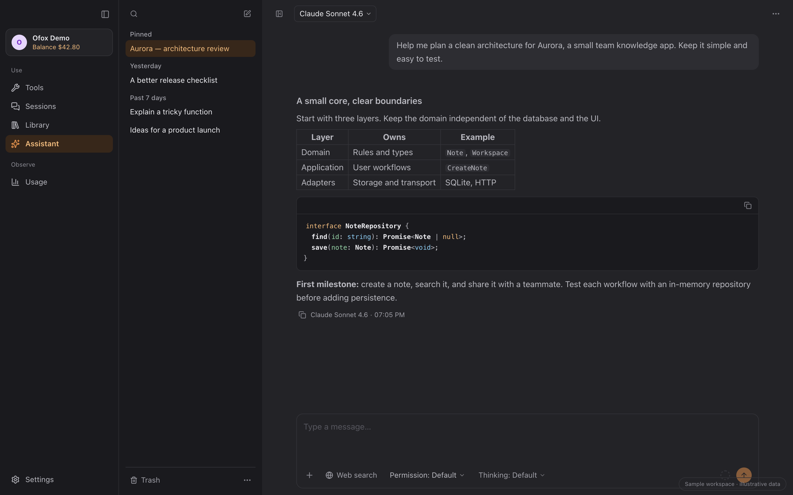
</picture>

### Sessions — pick up where you left off

Browse projects and local conversations across supported tools. Search, read, export, resume, or use the recoverable trash where the source supports that operation.

<picture>
<source media="(prefers-color-scheme: light)" srcset="assets/readme/sessions-light.webp">
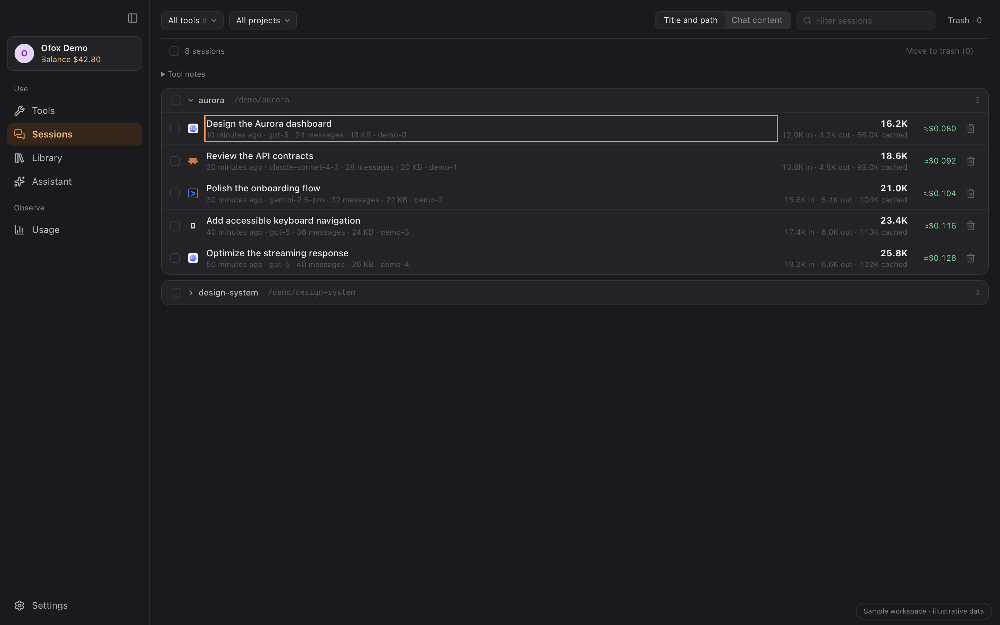
</picture>

Open full-size image: [Light](assets/readme/sessions-light.webp) · [Dark](assets/readme/sessions.webp)

### Library — configure once, choose the targets

Keep instructions, MCP servers, and Skills together. Discover native configuration, compare changes, and preview resource distribution before writing to selected applications.

<picture>
<source media="(prefers-color-scheme: light)" srcset="assets/readme/library-light.webp">
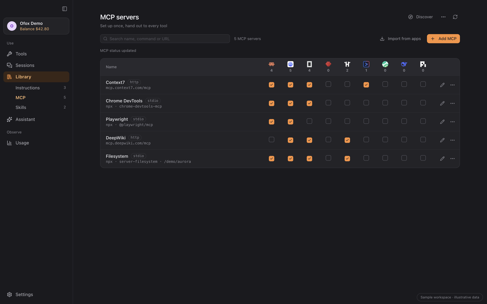
</picture>

Open full-size image: [Light](assets/readme/library-light.webp) · [Dark](assets/readme/library.webp)

### Discover — find your next capability

Browse curated MCP resources and Skills. Choosing a resource prepares a draft; collection, application, and a successful connection are separate states.

<picture>
<source media="(prefers-color-scheme: light)" srcset="assets/readme/discover-light.webp">
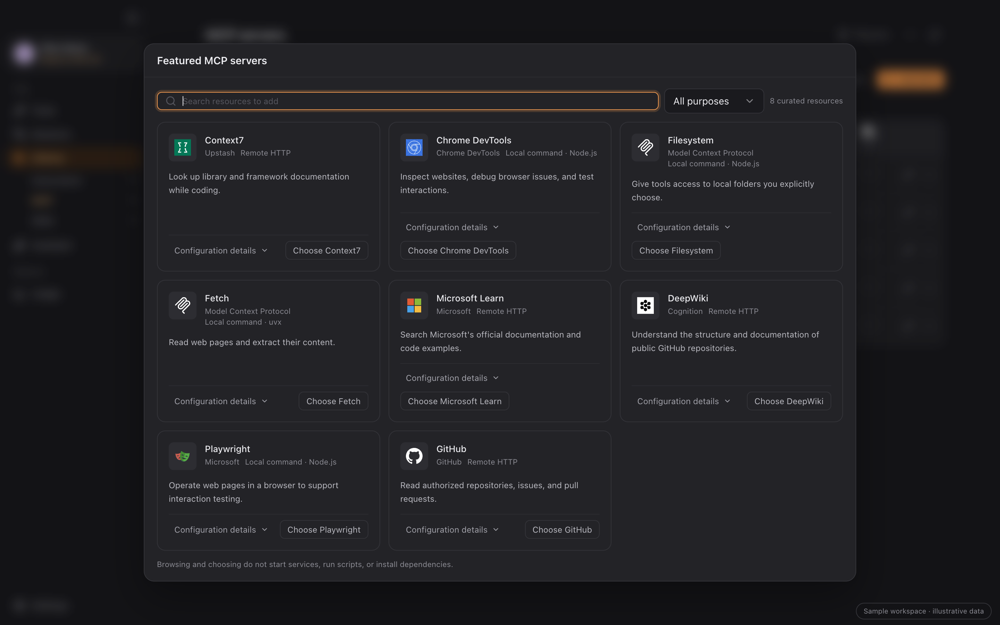
</picture>

Open full-size image: [Light](assets/readme/discover-light.webp) · [Dark](assets/readme/discover.webp)

### Usage — understand your activity

Explore local records by tool, project, model, and date. Inspect request details and export CSV. Coverage and unknown prices remain visible; estimates are separate from account billing.

<picture>
<source media="(prefers-color-scheme: light)" srcset="assets/readme/usage-light.webp">
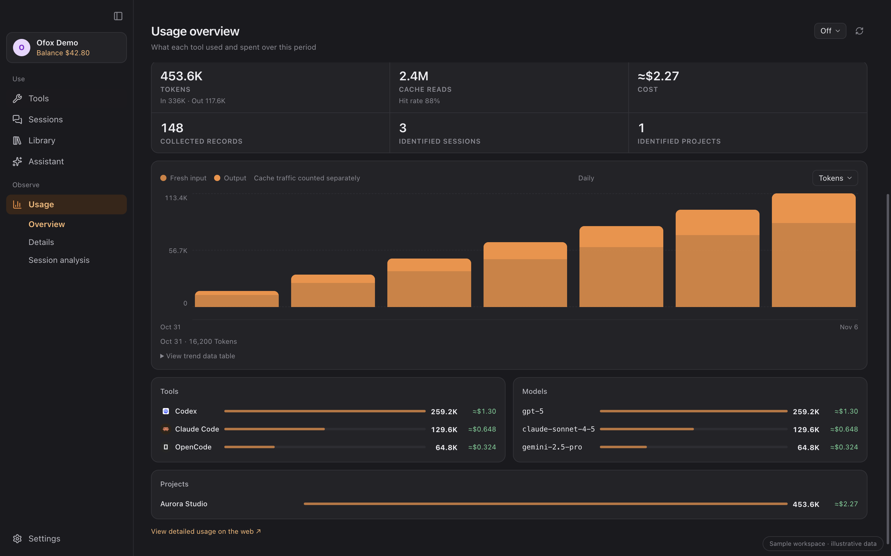
</picture>

Open full-size image: [Light](assets/readme/usage-light.webp) · [Dark](assets/readme/usage.webp)

<a id="compatibility"></a>

## Built around the tools you use

<picture>
<source media="(prefers-color-scheme: light)" srcset="assets/readme/tool-wall-light.svg">
</picture>

Ten supported tools, one setup flow. The matrix below lists the actions available to each tool.

| Tool                   | One-click access | Install / update                  | Sessions               | Usage     | MCP & Skills |
| ---------------------- | ---------------- | --------------------------------- | ---------------------- | --------- | ------------ |
| Claude Code            | ✓                | ✓                                 | Read · export · resume | ✓         | ✓            |
| Codex                  | ✓                | ✓                                 | Read · export · resume | ✓         | ✓            |
| ChatGPT (Codex mode)   | ✓                | Install / native update           | Via Codex              | Via Codex | ✓            |
| OpenCode               | ✓                | ✓                                 | Read · export · resume | ✓         | ✓            |
| OpenClaw               | ✓                | ✓                                 | Read · export          | ✓         | ✓            |
| Hermes                 | ✓                | ✓                                 | Read · export          | ✓         | ✓            |
| Gemini CLI             | ✓                | ✓                                 | Read · export · resume | ✓         | ✓            |
| WorkBuddy              | ✓                | Official download / in-app update | Read · export          | ✓         | ✓            |
| DeepSeek Harness (dsh) | ✓                | ✓                                 | Session list           | ✓         | ✓            |
| Pi                     | ✓                | ✓                                 | Read · export · resume | ✓         | ✓            |

**✓ Supported in 1.5.0.** Session cells list the available actions directly.

- **Install and update:** automatic installation supports Apple Silicon Macs and Windows. CLI updates follow the detected installation method; unrecognized sources show manual guidance. ChatGPT updates through its app on macOS and winget / Microsoft Store on Windows; WorkBuddy uses its official download and in-app updater.
- **ChatGPT and dsh:** ChatGPT's Codex mode shares Codex configuration and local sessions/usage; ordinary ChatGPT cloud chats are outside this integration. dsh requires 0.2+ and a profile initialized by running `dsh web` once; its session list shows metadata, without transcript reading, export, or resume.
- **Resources:** MCP and Skills cover all ten tools. Instructions additionally support Claude Code, Codex, Gemini CLI, OpenCode, and Hermes. Each tool retains its native format and protocol rules; Codex / ChatGPT share a physical target.
- **Usage:** local records provide usage analysis; Ofox account billing is a separate view. Coverage and price availability vary by source, so local estimates are not a complete provider bill.

Integration details: [configuration and data sources](docs/agent-wiring.md) · [tool updates](docs/tool-updates.md) · [resource support](docs/library-workbench.md) · [known limitations](docs/known-limitations.md).

<a id="download"></a>

## Download

| Platform    | Package                                    | Requirements                                                     |
| ----------- | ------------------------------------------ | ---------------------------------------------------------------- |
| **macOS**   | [Download `.dmg`](https://ofox.ai/desktop) | Apple Silicon, macOS 12+; signed and notarized official releases |
| **Windows** | [Download `.exe`](https://ofox.ai/desktop) | x64, Windows 10/11; NSIS installer, currently unsigned           |

[GitHub Releases](https://github.com/ofoxai/ofox-desktop/releases/latest) includes installers and `SHA256SUMS.txt`. Windows SmartScreen may show an unsigned-app warning; verify the source before using “More info → Run anyway.” Individual AI clients have their own system requirements.

Check for updates in Ofox settings or follow the in-app update notice.

<a id="faq"></a>

## Your data and configuration

<picture>
<source media="(prefers-color-scheme: light)" srcset="assets/readme/data-flow-light.svg">
</picture>

<details>
<summary><strong>Where do requests go?</strong></summary>

External AI tools send model requests directly to their configured service; Ofox Desktop manages their configuration and local statistics. Those tools can keep using saved configuration after Ofox Desktop closes. The built-in assistant sends its own requests to the selected service; optional search and MCP operations involve their respective services.

</details>

<details>
<summary><strong>How are credentials and configuration handled?</strong></summary>

Official releases keep saved login tokens and tool-key copies in the system credential store. Development storage is separate. Connecting a tool still writes its dedicated API key to the local configuration format that tool requires. Configuration changes check for conflicts and preserve unrelated fields; a multi-file operation can partially complete and reports individual results. Review [agent wiring](docs/agent-wiring.md) for the boundaries.

</details>

<details>
<summary><strong>Why can usage differ from my bill?</strong></summary>

Local records can omit events or prices, and tools record tokens differently. Account billing, saved amounts, and current price estimates are distinct. Coverage and unknown values are shown explicitly. See the [usage contract](docs/usage-analytics-contract.md) and [request panel](docs/usage-requests-alignment.md).

</details>

<details>
<summary><strong>Upgrading from an older macOS release?</strong></summary>

A signing-certificate change can make macOS ask again for access to existing Keychain entries. After verifying that the prompt belongs to the Ofox Desktop update, follow the system prompt and choose “Always Allow.” Reopen Ofox if you previously denied access; later prompts depend on system authorization and signing state.

</details>

Found an issue or have an idea? [Open an issue](https://github.com/ofoxai/ofox-desktop/issues) or [contribute a pull request](https://github.com/ofoxai/ofox-desktop/pulls). Please remove credentials and personal content from reports and attachments.

Feedback email: [**hi@ofox.ai**](mailto:hi@ofox.ai).

<a id="development"></a>

## Build with us

<details>
<summary>Build from source and contribute</summary>

Tauri 2 · React 18 · TypeScript · Rust. Requires Node.js 20.19+ (20.x) or 22.12+, pnpm 10, and Rust stable. Native platform dependencies: [Tauri prerequisites](https://tauri.app/start/prerequisites/).

```bash
pnpm install --frozen-lockfile
pnpm dev                 # Full Tauri application
pnpm dev:renderer        # Renderer only, port 3011
pnpm build:renderer      # Build web assets
pnpm build               # Build desktop application
```

Follow [AGENTS.md](AGENTS.md) and the [development standards](docs/code-standards.md) for checks and sandbox rules. Release procedures: [release gate](docs/code-standards.md#release-gate), [release workflow](.github/workflows/release.yml), and [branch packages](docs/branch-packages.md). Windows behavior needs native Windows verification.

</details>

<a id="license"></a>

## License and credits

[MIT](LICENSE). Reference projects: [cc-switch](https://github.com/farion1231/cc-switch) · [magpie](https://github.com/yetone/magpie). Thank you to their authors and contributors.

[Full sources and licenses](docs/acknowledgements.md)
