<div align="center">


# Ofox Desktop

### 一键接入 AI 工具，集中管理与创作。

在一个桌面应用中管理工具、会话、资源库、助手和用量。

[English](README.md) · **简体中文** · [日本語](README.ja.md)

[](#compatibility)
[](#compatibility)
[](#download)
[](LICENSE)

<h3><a href="https://ofox.ai/zh">官网</a> · <a href="https://ofox.ai/zh/desktop">官网下载</a> · <a href="https://github.com/ofoxai/ofox-desktop/releases/latest">GitHub Releases</a></h3>

[一键接入](#quick-start) · [工作台演示](#tour) · [核心功能](#features) · [工具支持](#compatibility) · [常见问题](#faq)

<picture>
<source media="(prefers-color-scheme: light)" srcset="assets/readme/hero-light.svg">
</picture>
</div>

_展示素材提供浅色与深色版本，随你的显示偏好切换。_

<a id="quick-start"></a>

## 第一次用 AI 工具？从一键接入开始。

1. **登录 Ofox 账号。** 用同一个账号接入你选择的受支持工具。
2. **选好工具。** Ofox 自动检测已安装的客户端，保留你想接入的工具；未安装的工具先通过可用安装器或官网下载页安装。
3. **点击一次「开始绑定」。** Ofox 为选中的工具管理专属 API Key，并写入各自的原生接入配置。逐项查看结果，冲突和失败会分别说明。

<picture>
<source media="(prefers-color-scheme: light)" srcset="assets/readme/binding-flow-light.svg">
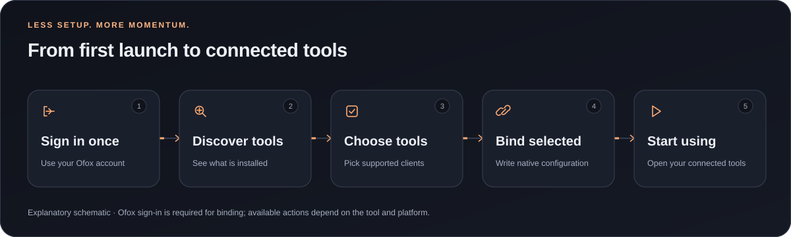
</picture>

### 观看一键接入演示

继续配置你的工具：[<kbd> 配置 MCP ↗ </kbd>](docs/resource-setup.md#zh-mcp) · [<kbd> 配置 Skills ↗ </kbd>](docs/resource-setup.md#zh-skills)

<picture>
<source media="(prefers-color-scheme: light)" srcset="assets/readme/onboarding-light.gif">
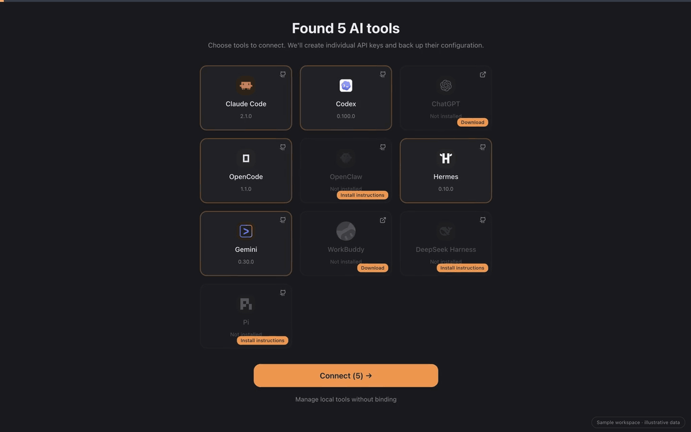
</picture>

**观看视频:** [深色版](assets/readme/onboarding.mp4) · [浅色版](assets/readme/onboarding-light.mp4)

_一键绑定发生在登录和选择工具之后，为已安装的受支持客户端写入配置；不等于自动安装所有工具，也不会改变所有已有会话。演示使用虚构数据，不是真实账户请求。_

只想使用本地管理？无需绑定也可进入受支持的本机功能。已接入的外部工具将模型请求直接发往其配置的服务，关闭 Ofox Desktop 后仍可使用已保存的配置。详见[绑定生命周期](docs/tool-lifecycle.md)。

<a id="tour"></a>

## 你的 AI 工作台，一眼看清

<picture>
<source media="(prefers-color-scheme: light)" srcset="assets/readme/tools-zh-light.webp">
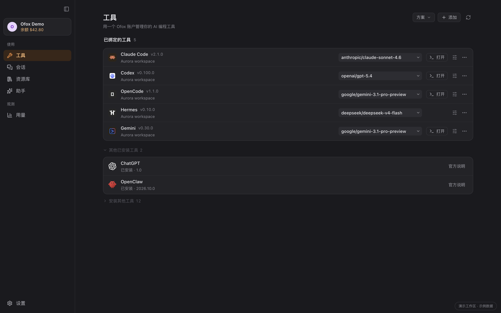
</picture>

管理本机工具，查看接入状态，预览多工具模型方案。安装和 Ofox 绑定分别记录；配置缺失时可显式恢复，解绑前先预览变更。

**工作台进阶视频：** [深色版](assets/readme/tour.mp4) · [浅色版](assets/readme/tour-light.mp4)

_截图与动图使用虚构演示数据和真实应用组件。助手内容仅作示例，不代表模型评测或真实请求成功证明。功能画廊与动图共用英文界面。_

<a id="features"></a>

## 五个入口，串起完整工作流

### 工具：少花时间配置，多做实际工作

发现本机工具、安装受支持的客户端、管理 Ofox 接入和模型。更新遵循检测到的安装来源；不可用操作会说明原因，或提供官方手动处理入口。Ofox 管理的地址随所选 `ofox.ai` / `ofox.io` 区域协调更新；你修改过的地址出现冲突时会明确提示。

### 助手：把问题变成下一步行动

与可用模型对话、添加文件、使用联网搜索，并保留本地对话历史。支持会话分叉、导出、语音输入和朗读。

- **图片生成**：把文字描述变成视觉素材，在同一段对话中继续创作。
- **视频生成**：直接在工作台发起视频创作，减少来回切换。
- **语音生成**：将文字变成语音，用于旁白、解说和朗读内容。

图片、视频和语音生成需要所选模型及账号支持；格式、权限、价格和可用性按具体操作分别判断。

<picture>
<source media="(prefers-color-scheme: light)" srcset="assets/readme/assistant-media-light.svg">
</picture>

<details>
<summary>查看图片、视频和语音生成界面</summary>

以下界面展示模型和参数选择，未发送生成请求。

**图片生成** — 选择模型、尺寸、质量和图片数量。

<picture>
<source media="(prefers-color-scheme: light)" srcset="assets/readme/assistant-image-light.webp">
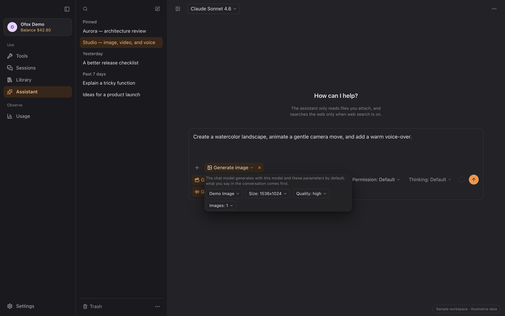
</picture>

**视频生成** — 设置时长、分辨率、画面比例和音轨选项。

<picture>
<source media="(prefers-color-scheme: light)" srcset="assets/readme/assistant-video-light.webp">
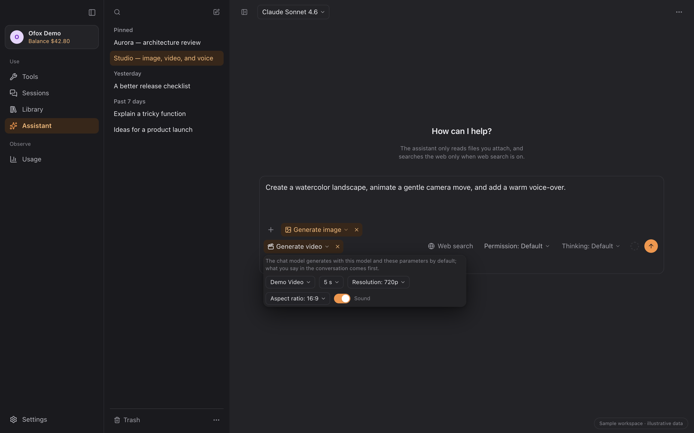
</picture>

**语音生成** — 为文字选择音色与输出格式。

<picture>
<source media="(prefers-color-scheme: light)" srcset="assets/readme/assistant-speech-light.webp">
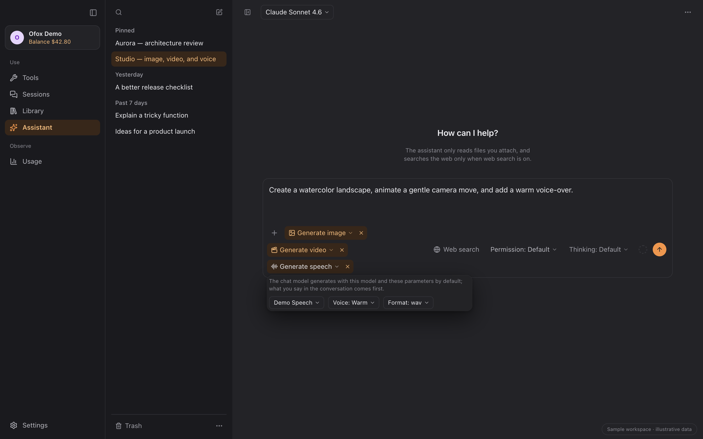
</picture>

</details>

**制作 PPT。** 用一句话描述你要的演示稿。助手会从 25 种风格中挑选，或使用你指定的风格；逐页规划，把图表、公式和示意图做成能在 PowerPoint 里编辑的对象；在你允许时加入生成的配图；交付前可以逐页预览。

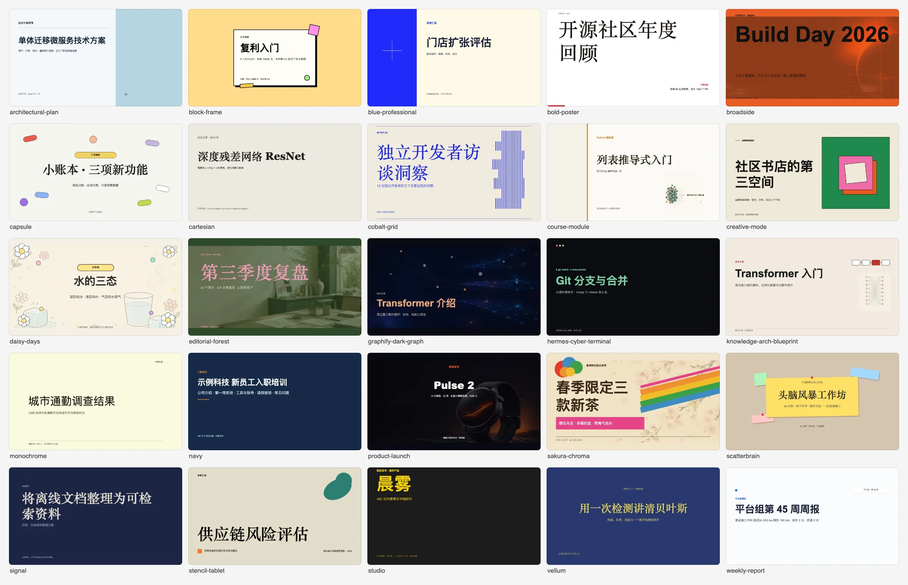

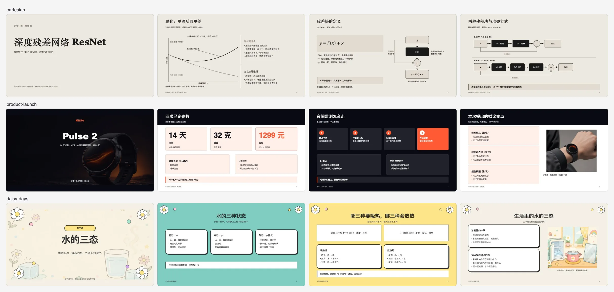

_图中每一页都来自助手按一句话需求实际生成的演示稿，内容为虚构示例（文字用 DeepSeek V4.1 Flash，配图用 GPT Image 2）。不同风格的排版质量有差异。可编辑的公式、图表数据和用代码绘制的图目前需要 macOS。_

**配置出问题，还有助手兜底。** 点击「用不了？让助手看看」，一键进入该工具的诊断对话。发送请求后，助手可排查配置、运行环境和 Ofox 接入，按所选权限执行修改并验证结果；无法解决的问题会明确说明。

<picture>
<source media="(prefers-color-scheme: light)" srcset="assets/readme/configuration-rescue-light.svg">
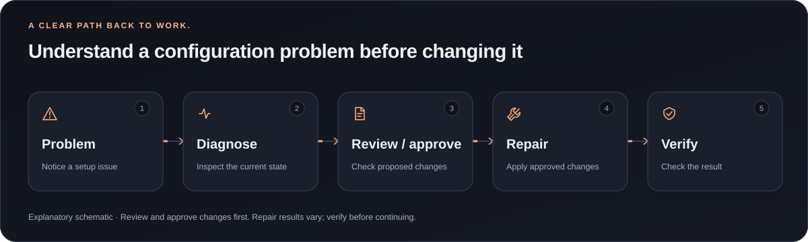
</picture>

<picture>
<source media="(prefers-color-scheme: light)" srcset="assets/readme/assistant-light.webp">
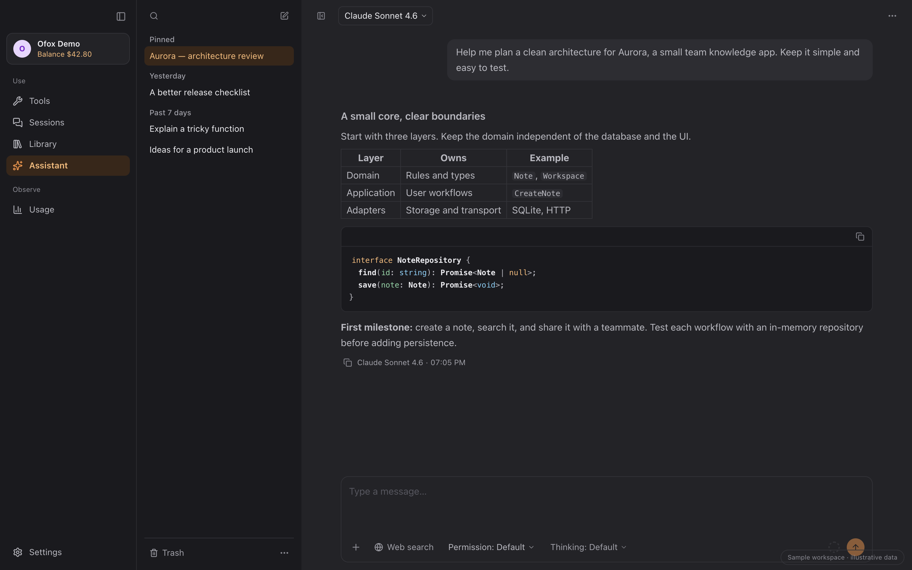
</picture>

### 会话：接着上次的工作继续

按项目浏览受支持工具的本地会话。根据来源能力搜索、阅读、导出、续聊，或使用可恢复的回收站。

<picture>
<source media="(prefers-color-scheme: light)" srcset="assets/readme/sessions-light.webp">
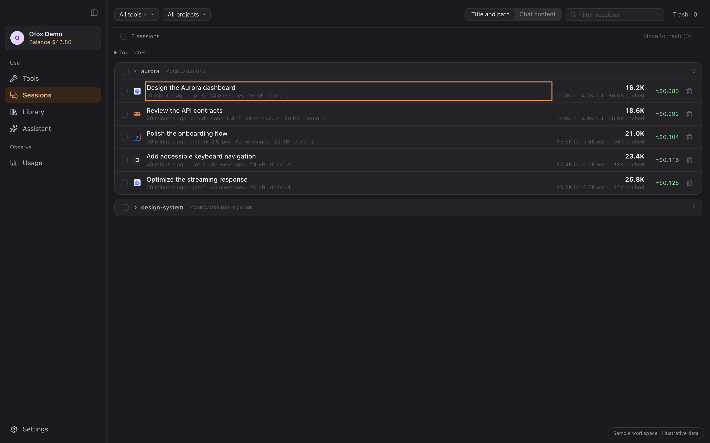
</picture>

查看原尺寸图片: [浅色版](assets/readme/sessions-light.webp) · [深色版](assets/readme/sessions.webp)

### 资源库：集中管理，选择目标

将指令、MCP 和 Skills 放在一起。发现原生配置、比较差异，预览后再分发到选中的应用。

<picture>
<source media="(prefers-color-scheme: light)" srcset="assets/readme/library-light.webp">
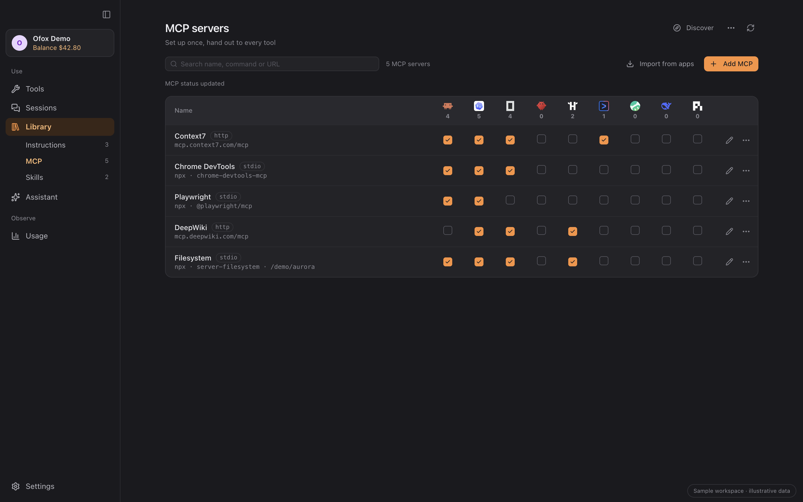
</picture>

查看原尺寸图片: [浅色版](assets/readme/library-light.webp) · [深色版](assets/readme/library.webp)

### 发现：找到下一个实用能力

浏览精选 MCP 和 Skills。选择资源先形成草稿；收录、写入应用和连接成功分别呈现。

<picture>
<source media="(prefers-color-scheme: light)" srcset="assets/readme/discover-light.webp">
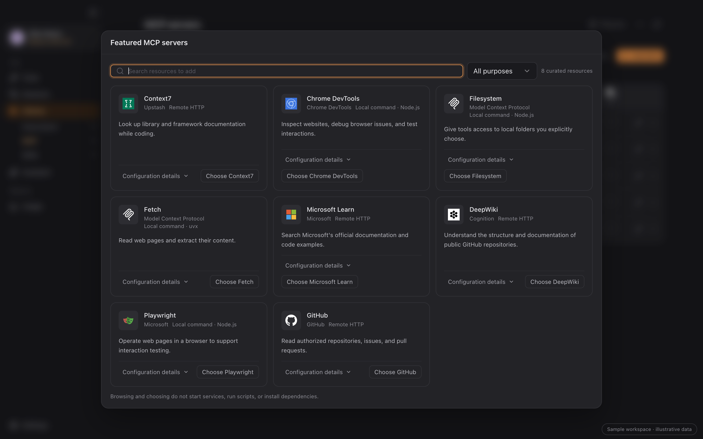
</picture>

查看原尺寸图片: [浅色版](assets/readme/discover-light.webp) · [深色版](assets/readme/discover.webp)

### 用量：了解每一段工作

按工具、项目、模型和日期查看本地记录，检查请求明细并导出 CSV。覆盖范围和未知价格明确显示，估算与账户账单分开。

<picture>
<source media="(prefers-color-scheme: light)" srcset="assets/readme/usage-light.webp">
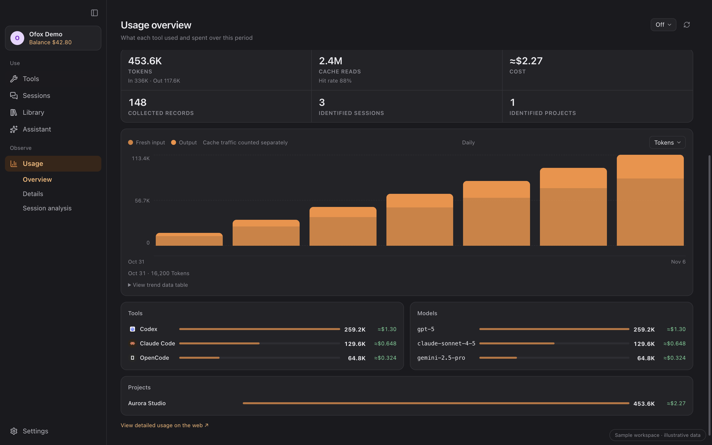
</picture>

查看原尺寸图片: [浅色版](assets/readme/usage-light.webp) · [深色版](assets/readme/usage.webp)

<a id="compatibility"></a>

## 围绕你常用的工具构建

<picture>
<source media="(prefers-color-scheme: light)" srcset="assets/readme/tool-wall-light.svg">
</picture>

十个受支持工具，一套接入流程。下表列出各工具的可用操作。

| 工具                   | 一键接入 | 安装／更新           | 会话             | 用量          | MCP 与 Skills |
| ---------------------- | -------- | -------------------- | ---------------- | ------------- | ------------- |
| Claude Code            | ✓        | ✓                    | 阅读／导出／续聊 | ✓             | ✓             |
| Codex                  | ✓        | ✓                    | 阅读／导出／续聊 | ✓             | ✓             |
| ChatGPT（Codex 模式）  | ✓        | 安装／原生更新       | 与 Codex 共用    | 与 Codex 共用 | ✓             |
| OpenCode               | ✓        | ✓                    | 阅读／导出／续聊 | ✓             | ✓             |
| OpenClaw               | ✓        | ✓                    | 阅读／导出       | ✓             | ✓             |
| Hermes                 | ✓        | ✓                    | 阅读／导出       | ✓             | ✓             |
| Gemini CLI             | ✓        | ✓                    | 阅读／导出／续聊 | ✓             | ✓             |
| WorkBuddy              | ✓        | 官网安装／应用内更新 | 阅读／导出       | ✓             | ✓             |
| DeepSeek Harness (dsh) | ✓        | ✓                    | 会话列表         | ✓             | ✓             |
| Pi                     | ✓        | ✓                    | 阅读／导出／续聊 | ✓             | ✓             |

**✓ 表示 1.5.0 已支持。** 会话列直接列出可用操作。

- **安装与更新：** 自动安装支持 macOS Apple Silicon 和 Windows。CLI 升级沿用检测到的安装方式，无法识别的来源提供手动说明。ChatGPT 在 macOS 使用应用内更新，在 Windows 使用 winget／Microsoft Store；WorkBuddy 使用官网安装和应用内更新。
- **ChatGPT 与 dsh：** ChatGPT 的 Codex 模式与 Codex 共用配置及本地会话、用量，普通 ChatGPT 云端聊天不在此接入范围。dsh 需要 0.2+，并先运行一次 `dsh web` 初始化配置；其会话列表展示元数据，不提供正文阅读、导出和续聊。
- **资源：** MCP 与 Skills 覆盖十个工具。指令另支持 Claude Code、Codex、Gemini CLI、OpenCode 和 Hermes；各工具沿用自己的格式和协议规则，Codex／ChatGPT 共用一个物理目标。
- **用量：** 本地记录用于用量分析，Ofox 账号账单单独展示。数据覆盖和价格完整度取决于来源，本地估算不等同于供应商完整账单。

详细说明：[配置与数据来源](docs/agent-wiring.md) · [工具更新](docs/tool-updates.md) · [资源支持](docs/library-workbench.md) · [已知限制](docs/known-limitations.md)。

<a id="download"></a>

## 下载

| 平台        | 安装包                                    | 要求                                                      |
| ----------- | ----------------------------------------- | --------------------------------------------------------- |
| **macOS**   | [下载 `.dmg`](https://ofox.ai/zh/desktop) | Apple Silicon、macOS 12+；正式版包含代码签名与 Apple 公证 |
| **Windows** | [下载 `.exe`](https://ofox.ai/zh/desktop) | x64、Windows 10/11；NSIS 安装包，目前未签名               |

[GitHub Releases](https://github.com/ofoxai/ofox-desktop/releases/latest) 附带安装包和 `SHA256SUMS.txt`。Windows SmartScreen 可能提示未签名应用；核实来源后，可在“更多信息”中选择“仍要运行”。各 AI 客户端仍有自己的系统要求。

在 Ofox 设置中检查更新，或查看应用内的新版本提示。

<a id="faq"></a>

## 数据与配置

<picture>
<source media="(prefers-color-scheme: light)" srcset="assets/readme/data-flow-light.svg">
</picture>

<details>
<summary><strong>请求发送到哪里？</strong></summary>

外部 AI 工具将模型请求直接发送到其配置的服务，Ofox Desktop 负责配置管理与本地统计。关闭 Ofox Desktop 后，这些工具仍可使用已保存的配置。内置助手自行向所选服务发送请求；可选的搜索和 MCP 操作涉及各自的服务。

</details>

<details>
<summary><strong>凭据和配置如何处理？</strong></summary>

正式版将保存的登录令牌和工具密钥副本存入系统凭据库；开发版使用独立存储。接入工具时，仍会按照工具要求，将专用 API Key 写入本机原生配置。配置改动会检查冲突并保留无关字段；跨文件操作可能部分完成，结果逐项显示。具体边界见[工具接线](docs/agent-wiring.md)。

</details>

<details>
<summary><strong>为什么本地用量可能与账单不同？</strong></summary>

本地记录可能缺少事件或价格，各工具的 Token 记录方式也不同。账户账单、历史保存金额和按当前价格估算的金额分别展示；覆盖范围与未知值明确说明。见[用量契约](docs/usage-analytics-contract.md)和[请求面板](docs/usage-requests-alignment.md)。

</details>

<details>
<summary><strong>从旧版 macOS 安装包升级？</strong></summary>

签名证书变更可能使 macOS 重新询问读取现有钥匙串条目的权限。确认提示来自 Ofox Desktop 的升级后，按系统要求操作并选择“始终允许”。此前拒绝过授权时，可退出并重新打开 Ofox；后续是否再次提示取决于系统授权和签名状态。

</details>

发现问题或有新想法？欢迎[提交 Issue](https://github.com/ofoxai/ofox-desktop/issues) 或[贡献 PR](https://github.com/ofoxai/ofox-desktop/pulls)。报告和附件中请移除凭据及个人内容。

反馈邮箱：[**hi@ofox.ai**](mailto:hi@ofox.ai)。

<a id="development"></a>

## 一起构建

<details>
<summary>从源码构建与参与贡献</summary>

Tauri 2 · React 18 · TypeScript · Rust。需要 Node.js 20.19+（20.x）或 22.12+、pnpm 10 和 Rust stable。平台依赖见 [Tauri 前置要求](https://tauri.app/start/prerequisites/)。

```bash
pnpm install --frozen-lockfile
pnpm dev                 # 完整 Tauri 应用
pnpm dev:renderer        # 仅 renderer，端口 3011
pnpm build:renderer      # 构建网页资源
pnpm build               # 构建桌面应用
```

检查和沙箱约定见 [AGENTS.md](AGENTS.md) 及[开发标准](docs/code-standards.md)。发版说明：[发布门禁](docs/code-standards.md#release-gate)、[发布工作流](.github/workflows/release.yml)和[分支安装包](docs/branch-packages.md)。Windows 行为需要在 Windows 原生系统验证。

</details>

<a id="license"></a>

## 许可与致谢

[MIT](LICENSE)。参考项目：[cc-switch](https://github.com/farion1231/cc-switch) · [magpie](https://github.com/yetone/magpie)。感谢项目作者与贡献者。

[完整来源与许可](docs/acknowledgements.md)
