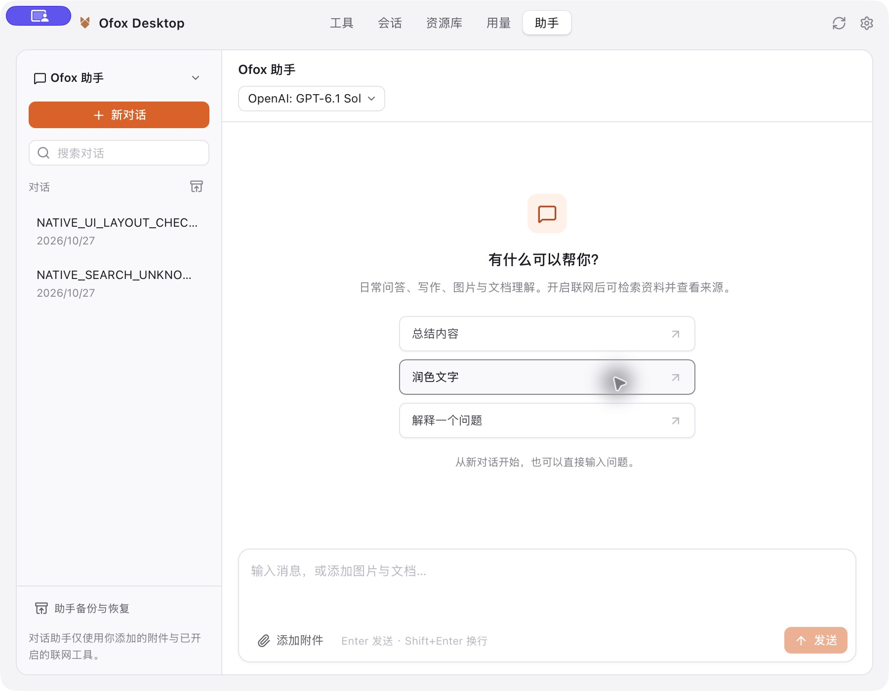
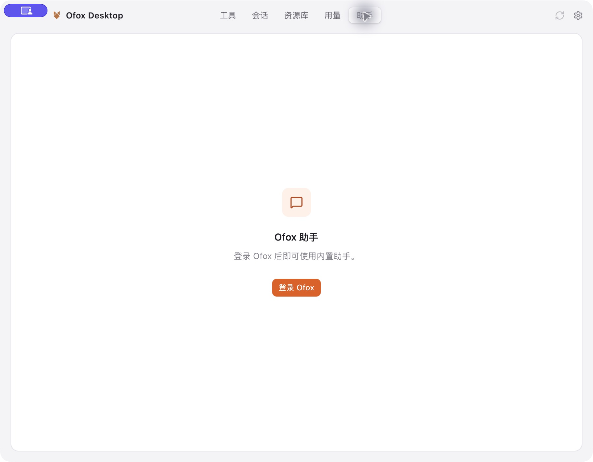

# Built-in assistants

Ofox Desktop adds an **Assistant** page after Usage: **Tools · Sessions · Library · Usage · Assistant**. Tools remains the initial page. Ofox Assistant provides general conversation, document/image reading and optional billed web search. Configuration Assistant uses separate conversations and transient permissions. External CLI histories remain in Sessions.

The Assistant page requires the application's verified sign-in state. Signed-out users see a dedicated sign-in view without mounting the assistant workspace, loading its data or registering its refresh handler. Its button enters the existing login flow; local tool management remains available without signing in. Profile metadata arriving late, including a stable ID added to an older cached email-only profile, preserves the current draft. Proven account/organization/region changes and sign-out still replace private workspace state.

## Runtime and identity

The private sidecar bundles Pi SDK 1.4.0 and Node 24.22.1 LTS. See [runtime protocol and packaging](../assistant-runtime/README.md). It does not discover the user's Pi installation, extensions, project instructions, MCP servers or tools. Rust owns OAuth refresh credentials and passes only a short access token through private stdio. Recognized credentials are scrubbed before native history, UI events, operation records and export.

Identity comes from the authenticated user and billing organization, with separate histories, memories and model preferences. Requests freeze the resolved Ofox region. Login, logout, region changes and permission changes invalidate running work and approvals. Existing OAuth grants do not acquire `llm.invoke` through refresh or metadata writes: users must authorize the added scope.

Normal login requests the complete grant and falls back to the original scopes once only for an explicit OAuth `invalid_scope` response. Other failures do not downgrade. Assistant authorization has its own dialog and verifies the same account and organization before replacing credentials; cancellation or failure keeps the previous session. Old profile responses cannot expire or overwrite a newly granted session. Local history, readable export and complete backup/restore require account identity, not `llm.invoke`, a live model service or model balance.

The entire application requires **macOS 13.5 or newer**, matching the bundled Node runtime. macOS 12–13.4 cannot run this release. Raising the minimum OS version does not itself move or delete local configuration, history or Keychain entries. No user-installed Node/Pi is required for chat. Installing external CLI tools can still require the tool's supported package manager and OS prerequisites.

## Conversation data

Pi native JSONL is the model-context authority. SQLite settings hold a versioned UI projection without changing database schema 11. Native run markers connect user/assistant entries to the correct UI run after interruption. Before another send or branch, existing native history is reconciled without a model request. Missing or unreadable native history is never silently replaced by an empty conversation.

Streaming events reach the UI immediately; durable text/thinking updates are coalesced at approximately 500 ms with an additional size bound. Completion, errors, Stop and shutdown flush remaining content. Reading an active conversation does not wait for its native writer lock, so pending approvals can reappear when switching back.

Editing and regenerating create native branches and preserve previous message versions. Context compaction preserves original history. The UI keeps the user's original text and attachment references rather than showing the extracted attachment prompt. User-saved memory is separate for each account, organization and assistant.

Assistant Markdown highlights explicitly labelled code blocks using the bundled common language grammars. Code is never executed; HTML remains escaped and remote images remain blocked. Unknown/unlabelled languages remain plain text. Highlighting is bounded to 32 Ki UTF-16 code units per block and 64 Ki per message; larger blocks retain their entire readable/copyable source. The external Sessions reader keeps its existing default rendering and search marking. Completed messages remain memoized while another reply streams.

Attachment-only messages can be edited, and empty failed or stopped replies retain a regeneration action. Regeneration rebuilds the original user input and attachment selection. Input preparation failures before any provider call are saved as actual native failed turns, allowing a model or memory change and an explicit retry without losing history. Stop also covers preparation: the UI cancels pending dispatch, and the backend serializes early cancellation receipts with run registration so a late request cannot start or replay that operation.

The model picker is available before the first conversation. When the remembered model and balanced mapping are unavailable, users can choose another catalog model rather than being trapped in a failed creation flow. Conversation usage shows incomplete coverage and leaves unknown token counts unavailable.

Draft text and selected attachment IDs are autosaved together, retained across conversation switches and included in complete archives. Backup and restore preview flush drafts first. Draft writes are serialized with sending; editing and regeneration retain the unsent composer. Unloaded and trashed conversations are not overwritten with default drafts. Account changes and unmount invalidate queued writes, with backend owner/generation comparisons as an additional fence. Successful restore refreshes that fence before further changes.

Imported attachments are private copies of selected files. Permanent deletion removes the owned native history and copies, never the user's source files. Single-conversation JSON remains **Readable export** and excludes the assistant's unrelated long-term memories; complete backup includes them. The existing `.db` feature is a **Configuration database snapshot**, not a complete assistant migration.

**Assistant backup and restore** handles the current account and organization, both assistant kinds, all branches and Trash, drafts, memories, preferences, local usage, native history and attachment copies. Format 1 pins native SDK 1.4.0 and runtime protocol 1, with identity and per-file size/SHA-256 metadata. It excludes credential stores, runtime binaries, temporary grants, pending approvals and running tasks. The current account must stop its tasks before either operation; stale interrupted records are marked incomplete. User-provided attachment contents are preserved and may themselves contain sensitive material.

SQL exports and manual/automatic WebDAV exports omit assistant-owned settings at their source. SQL/WebDAV imports and database-snapshot restores preserve the latest local assistant namespace under the final connection lock, including writes committed after staging began. Assistant statements suppress only their own synchronous settings notifications, not concurrent configuration changes. Configuration imports reject executable or transient schemas rather than allowing triggers or virtual tables to copy private history into ordinary exportable tables.

Archive preview validates identity, format/runtime versions, paths, checksums, all required files, the native entry tree and UI/native references. Identical records are skipped; conflicting IDs keep the local version and are reported. Memory merges by item ID; usage is never copied under a newly invented conversation ID. Identical projections with missing or differing native files report a file conflict. Recovery does not overwrite an existing conflicting file. A preview expires on identity/lifetime changes and after 15 minutes; local changes require another preview.

Restore stages verified files and uses durable preparation/restore/cleanup phases and a SQLite commit receipt. Final assistant rows and the receipt commit in one transaction. Sources survive until commit and cleanup so restart can complete committed files or roll back owned new directories. Cleanup and rollback first rename their directories; interruption during recursive deletion is recoverable. Large file IO and hashing run outside the configuration DB lock; the final transaction rechecks its local snapshot. Restore never calls provider configuration synchronization, restores Ask permissions and never replays historical actions.

Safety limits are 2 GiB archive/uncompressed file total, 512 MiB per native history, 25 MiB per attachment, 64 MiB manifest/journal and 20,000 ZIP entries. An oversized or incomplete source fails clearly and leaves an existing export intact. Corrupt or unsupported history is not replaced with an empty conversation. Native Windows durability, filesystem and process acceptance remain separate gates.

## Permissions and operations

New configuration conversations use Ask. Read-only exposes sanitized file/status checks. Controlled process diagnostics require authorization; automatic configuration permits registered configuration/install/diagnostic tools, while arbitrary shell commands still require separate approval. Full Access explicitly permits arbitrary host commands/files and cannot guarantee that a model can never obtain credentials.

The Configuration capabilities dialog and runtime tool descriptions share the backend action registry. It distinguishes automatic actions, confirmation, Tools-page handoff and unsupported actions for each tool and mode. Partial static checks and installer prerequisites are explicitly disclosed. No intelligent-approval mode or framework-switching UI is provided.

Permissions and exact-operation approvals live only in memory. Downgrading, account changes and logout invalidate pending work. Configuration writes reuse existing adapter transactions and revision checks inside the adapter write lock. Status coverage that requires legacy unmanaged probes is reported as partial rather than launching an unowned process. Native desktop installers and unavailable package-manager prerequisites return an explicit Tools-page handoff.

Owned processes use Unix process groups or Windows Job Objects, bounded output and deadlines. Stop first asks Pi to persist an interrupted turn, then enforces shutdown. App exit waits for owned tasks and aborts remaining tasks. This is process ownership, not an OS sandbox; Full Access cannot constrain programs that deliberately escape their process group or create external services.

Paid search and mutating operations with an unknown result are not automatically replayed. Native tool-call IDs, host-side operation claims, sequential tool execution and a run-wide unknown-outcome gate protect queued operations as well as repeated calls.

## Search, pricing and rollout

The companion backend provides authenticated `GET /openapi/assistant/capabilities`. Standalone `POST /v1/search` stays closed to ordinary public credentials; core verifies the Desktop OAuth client and `llm.invoke` before granting search access. The server's explicit Desktop client allowlist defaults empty. Deploy the backend and update the OAuth client's allowed scopes before enabling desktop rollout.

Existing older clients check release version and platform without a minimum-OS field. New code or metadata cannot retroactively change those installed clients. Before publishing this release, the legacy update manifest and download entry points must be handled so macOS 12–13.4 users are not directed to replace a usable old installation with an incompatible package. A new-client OS guard alone does not complete this rollout gate.

The 2026-10-27 read-only rollout audit verified the installed 1.3.8 application's plist and Mach-O both still require macOS 12.0. The historical `1.3.8_20261026_1215` source declares the same system requirement; its version/URL matching algorithm is preserved in regression coverage. A client-equivalent public manifest request (`User-Agent: ofox-desktop`) returned 1.3.8 with both Mac and Windows download entries; the default Python user agent was rejected with HTTP 403. No live manifest or historical artifact was changed.

The user selected two manifests with one manual migration for old Mac clients. The implementation keeps the legacy Mac URL pinned to 1.3.8, advances valid Windows entries, and moves new clients to `latest-v2.json`. New clients require protocol 2 and verify the actual Mac system version against `minimumMacOS`; incompatible, unknown or malformed compatibility data cannot offer a download. UI failure messages cover zh/en/ja.

Both release paths now share the conditional R2 publisher. They preserve required existing platform entries, reject unknown reads and malformed JSON, repair newer non-Mac entries across a partial publication, serialize through a remote ETag lease and conditionally publish each feed. Installers are immutable: an existing key must match the staged file's size and SHA-256. Unknown writes are not automatically replayed; active locks have no timeout-based stealing. Emergency publishing now requires R2 S3 credentials and an AWS CLI that supports both conditional write options. Neither the new feed nor this policy has been deployed. The first release needs a version higher than 1.3.8 plus live feed/download-entry acceptance. See [update-feed operations and recovery](update-feeds.md).

Search requires schema version 1 and a valid positive USD/request price and price version. The desktop rechecks the price and identity before dispatch. Static webpage reading uses HTTPS, public DNS/IP pinning, redirect/size/time limits and only conversation-provided or search-result URLs; it has no browser login state.

The Usage page shows a separate, identity-scoped summary of locally retained built-in conversations, including Trash. It never scans the assistant's private JSONL as an external Pi source or adds these estimates to external CLI totals. Model/compaction tokens, cache usage and search charges remain distinct. Unknown pricing is not zero; billed cost is unavailable until an authoritative assistant-specific billing response exists. Permanently deleting a local conversation removes it from this local summary; the account's cloud bill is unaffected.

## Verification boundaries

Tests use temporary storage, fake credentials and mock providers. Installed external CLI version probes returned `codex-cli 0.162.0` and `pi 1.3.0`; these probes do not validate live binding changes or the new assistant host path. Native SDK tests exercise streaming, cancellation, branching, recovery, attachment capability failures, compression, error/retry behavior, protocol routing and credential scrubbing. The desktop UI is checked at 900px in light/dark themes and with the keyboard using synthetic IPC.

Native Windows installation/Job behavior, official Developer ID signing/notarization, clean-machine macOS/Windows installation, real-account paid requests and the same-model Cherry comparison remain release/rollout gates. A macOS fixture or cross-platform source review does not validate Windows. See [Windows testing](windows-testing.md) and [known limitations](known-limitations.md).

### Verification snapshot — 2026-10-26

- Desktop: `pnpm typecheck`, `pnpm format:check`, `pnpm build:renderer`, all 1,554 frontend tests, `cargo fmt --check`, Clippy all-targets with `-D warnings`, and all 3,454 Rust tests passed. Fourteen existing opt-in manual/performance tests were ignored; no new assistant test was ignored. Rust ran with the shared integration target and incremental output disabled for the final full gate.
- Runtime: 25 tests passed using the pinned real Pi SDK and synthetic providers. Production dependency closure, native PDF/canvas and macOS ad-hoc signed smoke passed. Isolated 900px light/dark, keyboard, approvals, streaming/stop and usage UI checks passed; synthetic IPC only.
- Backend companion: core/gateway Go race suites, capability/credential/price tests and eight PostgreSQL-engine OAuth-scope backfill regressions passed. Seventeen existing real PostgreSQL wallet tests were skipped because the local mirror/container service was unavailable. Full gateway lint retains 16 pre-existing findings; changed-file lint and core lint passed. These results do not certify a production deployment or real billing flow.
- Independent reviews covered frontend races, host authority/storage/process lifecycle, runtime/packaging and the OAuth scope backfill. Reported defects were resolved. No real configuration was mutated, no CLI was installed/updated for failure testing, and no paid inference/search request was sent.

A native-history disk-write failure may leave the SDK waiting until Stop or the host's bounded run deadline. Interrupted or unverifiable accounting remains explicitly incomplete with an unavailable total estimate; it never becomes a complete zero-cost total.

### Whole-application macOS minimum update — 2026-10-26

The whole application now declares macOS 13.5. Release verification checks the App's actual `LSMinimumSystemVersion` inside the DMG against Tauri configuration, accepts equivalent numeric forms such as 13.5.0, and records the declared minimum in the immutable publish proof. Missing or mismatched proof metadata blocks publishing. The emergency uploader uses the same DMG check before notarization or R2 access, including `--skip-build`.

The added release-policy regressions first failed (six RED) and then passed. Final checks: 1,561 frontend tests; 3,455 Rust tests with 14 existing opt-in tests ignored; typecheck, frontend/script formatting, Rust formatting, shell syntax, and Clippy all-targets with warnings denied all passed. Rust checks ran with `MACOSX_DEPLOYMENT_TARGET=13.5`; the compiled library's Mach-O minimum was inspected and is 13.5. A cross-component guard also verifies the application requirement agrees with the bundled runtime manifest. Independent review found no remaining issue in this increment.

This does not certify execution on a macOS 13.5 machine or a new officially signed/notarized installer. Native acceptance, the legacy update-feed compatibility rollout and server-side OAuth/search enablement remain separate release gates.

### Design revision verification — 2026-10-27

Verified on macOS 26.5.1, Apple Silicon, from base commit `2272e645141d92800b91f7f8f3d4c71c35a7b60e` plus this uncommitted development tree. No installation package, tag, push or production deployment was created.

- Final gates: 1,566 frontend tests; 3,481 Rust tests passed with 14 existing opt-in tests ignored. Typecheck, source/test/runtime formatting, Rust formatting, all-targets Clippy with warnings denied and the renderer production build passed. Rust ran with `MACOSX_DEPLOYMENT_TARGET=13.5`; the resulting native test binary reports Mach-O minimum 13.5.
- Bundled runtime: 27 tests passed against Pi SDK 1.4.0 and mock providers, including relocated native history/attachment continuation, editing, regeneration and read-only tool registration. The copied production dependency tree passed Node 24.22.1, native canvas, PDF and native JSONL smoke checks. No paid model/search request was made.
- Regression coverage: private SQL/WebDAV exclusion; late local writes across SQL/snapshot restore; triggers, TEMP shadows, FTS virtual/shadow storage and PRAGMA-alias shadows; archive identity/version/checksum/path validation; native tree/UI references; duplicate/conflict/memory merging; preparation, rollback and cleanup interruption; destination links; stale identity before commit; buffered streaming tails; active-session approval recovery; scope fallback and refresh bounds; cancelled/mismatched upgrades; late profile replies; disposed usage listeners.
- Isolated browser fixtures passed Chinese light, English dark and Japanese dark layouts at 900px, visible close controls, keyboard wrap/Escape/focus return, backup conflict preview and cancelled extra authorization. A separate 600-message synthetic transcript opened and still allowed assistant switching. These are fixture checks, not native application or cloud billing performance measurements.
- Independent read-only reviews covered data/restore security, authorization and streaming, and frontend lifecycle/accessibility. Reported findings were reproduced and closed. Temporary UI fixtures were removed. Local verification logs use the `ofox-assistant-revision-*` prefix under the system temporary directory; final Rust evidence is `final2-rust.log`/`final2-clippy.log` and frontend evidence is `final-frontend.log`.

Production OAuth/search deployment and allowlist enablement, the legacy-client update-entry compatibility rollout, native macOS 13.5 and Windows clean-machine acceptance, official signing/notarization, real billing and same-model Cherry parity remain independent release gates. No new installer should be published until they pass.

An additional native development build completed and started on macOS 26.5.1 with a separate application identifier and a temporary profile containing only fixture credentials. Startup initialized the schema-11 database and restored the fixture OAuth session. This check did not reach a native IPC conversation or backup/restore round trip: the desktop was locked and required manual unlocking for UI automation. The development application and localhost fixture services were stopped afterwards; the installed application was left running. Startup logs and a bounded evidence report are retained under the temporary `ofox-assistant-native-qa-` prefix. This is startup evidence only, not native UI or minimum-OS acceptance.

### Completeness audit and follow-up verification — 2026-10-27

The requirement audit found and repaired missing empty-message actions, a first-model selection dead end, silently truncated document extraction, sparse worksheet column loss, incomplete conversation accounting, attachment-draft persistence and unrelated memory in readable exports. Regression tests also exposed races involving unloaded drafts, in-flight draft saves versus sending, unmount/account changes, restore generation changes and stopping before run registration. Each reproduced failure was followed by the corresponding repair and independent read-only review.

| Requirement                                   | Current evidence and boundary                                                                                                                                                                                                                                                                                                                                          |
| --------------------------------------------- | ---------------------------------------------------------------------------------------------------------------------------------------------------------------------------------------------------------------------------------------------------------------------------------------------------------------------------------------------------------------------- |
| Bundled Pi/Node and private runtime           | Pinned SDK 1.4.0 / Node 24.22.1, real-SDK mock-provider tests, copied production dependency smoke, native canvas/PDF/JSONL smoke. No dependence on an installed CLI.                                                                                                                                                                                                   |
| General chat, streaming, stopping and history | Runtime, host and UI regressions cover streaming tails, native branches, interruption, input rejection/retry, early cancellation receipts and account/session fencing. Live paid parity remains pending.                                                                                                                                                               |
| Model selection and context budgets           | Catalog capacity, protocol, modality and price projection tests; a model can be chosen before conversation creation; compaction retains original native entries.                                                                                                                                                                                                       |
| Documents and images                          | Image/PDF capability checks, portable attachments, text/Office pagination and sparse XLSX coordinates are tested. Extraction is bounded to 16 Mi UTF-16 code units with explicit truncation warnings; text cache is bounded to 32 Mi units. A macOS 26.5.1 native text-attachment run passed; minimum-OS and Windows acceptance remain pending.                        |
| Search, page reading and citations            | Mock gateway/capability/price tests, source links, public HTTPS/DNS/IP/redirect/size checks and unknown-outcome refusal. No production OAuth/search rollout or paid request has been certified.                                                                                                                                                                        |
| Configuration assistant                       | Four modes, backend authority, registered action capabilities, exact approvals, configuration transactions and owned-process cancellation have tests. Native Windows process ownership and installed-tool acceptance remain pending.                                                                                                                                   |
| Local data and backup                         | SQL/WebDAV privacy, final-lock preservation, complete archive validation/merge/recovery, attachment-draft round trip and old-row compatibility pass in isolated fixtures. Readable conversation export excludes global memories. A native UI round trip into a second empty temporary profile passed, including duplicate import and restored attachment continuation. |
| Drafts and retained usage                     | Draft text/attachment IDs persist together, backup preparation flushes them, send/save ordering and stale authority are fenced. Unknown token counts are unavailable and incomplete coverage is visible in the conversation and Usage page.                                                                                                                            |
| Existing functionality                        | Full repository regression gates run alongside the new tests; live settings, credentials, installed agents and historical release packages were not altered for testing.                                                                                                                                                                                               |
| Layout and responsiveness                     | Three-language copy/placeholder parity and keyboard tests, historical 900px fixture checks, plus a regression proving unchanged Markdown is not reparsed for each streamed fragment. The latest native desktop UI and target-OS measurements still require acceptance.                                                                                                 |
| Server financial and scope rehearsal          | An isolated native PostgreSQL 16 database passed 17 financial tests (33 with subtests), zero skipped, plus eight synthetic OAuth registration/backfill cases. No real account, grant or balance was changed.                                                                                                                                                           |
| Publication                                   | Held: legacy update-entry compatibility, configured deployment/registration/allowlist, macOS 13.5 and Windows machines, signing/notarization and real billing/Cherry comparison remain separate unmet gates.                                                                                                                                                           |

These rows distinguish implementation evidence from deployment and target-OS acceptance. They are not a claim that the release gates have passed. The executor currently has no configured deployment context; an authorized test/gray-release environment has been requested. The Mac was unlocked for the subsequent native UI checks below. No new installer should be published while the release gates remain unmet.

Final local checks after these repairs: 1,577 frontend tests across 179 files; 3,485 Rust tests across 20 suites with 14 existing opt-in tests ignored; 31 pinned-SDK tests; typecheck, source/test/runtime formatting, all-targets Clippy with warnings denied, renderer build and copied production runtime smoke passed. The native test binary reports macOS minimum 13.5. Independent reviews covered the final UI, native cancellation receipts, input rejection, attachment extraction and storage changes.

One unconstrained Rust run while the frontend/Vite workload was active failed two existing subprocess fixtures: installation-source detection timed out, and a catalog safety fixture returned `failed` instead of its expected `partial` result. Both passed when run individually; the final complete Rust command passed with `-- --test-threads=4` and no competing frontend build/test workload. This is consistent with load-sensitive subprocess probes, but the second failure did not expose a diagnostic cause. Application probe deadlines and safeguards were not relaxed. Keep the failed run visible rather than treating it as a pass. The final Rust evidence is `ofox-assistant-completion-final3-rust.log`; frontend/type/format/Clippy/renderer evidence uses `ofox-assistant-completion-final2-*`; SDK/production smoke uses `ofox-assistant-completion-final-*`, all under the system temporary directory.

### Local service-chain rehearsal — 2026-10-27

A separate fixture environment ran App, Console, Core, Analytics server/worker and the actual Gateway plugin on Traefik 3.6.14, with PostgreSQL 16, Valkey 8, synthetic identities and mock model/search providers. App and Console used their frozen dependencies and Node 24.22.1. No production environment files or credentials were loaded.

- App issued real opaque OAuth access/refresh tokens through its HTTP PKCE exchange. The verified fixture identity, public Desktop registration and consent code were seeded; this does not certify browser consent or a deployed registration. Console rejected an unauthenticated request and accepted a locally signed Access assertion; model/provider records were created through Core's authenticated Console API.
- Core advertised schema-1 search capability with a positive USD/request price and price version. Gateway kept ordinary public search disabled. Nine authorization checks covered old read-only access, missing `llm.invoke`, refresh without scope escalation, ordinary API keys with spoofed headers, unlisted OAuth clients and explicit `invalid_scope`. Denied requests did not reach the mock provider. Removing the server allowlist also blocked a previously cached search route while balance access remained available.
- The pinned SDK completed two streamed model calls around one host search call and returned a source link. Only this temporary test's injected transport redirected Ofox requests to loopback; the production endpoint policy was unchanged. The issued access token was absent from native history. This exercises SDK/Gateway interoperability, not the native Rust host or desktop UI.
- Two successful search requests and two successful model requests produced four wallet transactions: USD 0.02000 for search plus USD 0.00014 for model tokens. Re-ingesting an existing search span twice preserved its ID, wallet debit and transaction count. These are synthetic charges in a disposable wallet, not real-account billing certification.

The fresh Analytics fixture applied structural migrations through 017; its historical cross-database user-ID backfill was inapplicable to the empty fixture and was excluded. Initial fixture wiring failures were corrected before the assertions above passed; they are not reported as successful checks. Evidence and temporary harnesses use the `ofox-assistant-chain-` prefix under the system temporary directory. Owned services and database volumes were removed after verification; unrelated Docker services and the installed application were preserved.

Production OAuth/search deployment, real billing and same-model Cherry parity, live legacy update-entry compatibility, target-OS acceptance and official signing remain unmet release gates. This rehearsal does not authorize publishing an installer.

### Dual update feeds and native UI verification — 2026-10-27

The selected [dual-feed migration](update-feeds.md) is implemented locally: the legacy Mac URL stays pinned to the existing 1.3.8 package, Windows can advance, and new clients read only the system-aware v2 feed. CI and emergency publishing share a conditional R2 lease, immutable artifact checks and ETag-based feed writes. Independent reviews closed publication-race, partial-feed divergence, version-reuse and macOS Bash 3.2 findings. No live manifest or historical installer was changed. Local gates passed 1,627 frontend tests across 182 files and 3,489 Rust tests across 20 suites, with 14 existing opt-in tests ignored; typecheck, formatting, all-targets Clippy and renderer build passed. Logs use the temporary `ofox-dual-feed-` prefix. One build was deliberately interrupted after its disk-space guard was not propagated by orchestration; the later guarded full run passed, and the interrupted log is retained.

After unlocking, an ad-hoc signed development app with a separate identifier ran on macOS 26.5.1 at 1000 × 700, using two temporary profiles, fixture credentials, the bundled Node/SDK and a local mock provider. Its environment preserved the real home but selected a temporary application home and system-only PATH. It did not load production credentials, modify live tool configurations or replace the installed application.

- Real Tauri IPC and native file dialogs imported a text attachment and saved a complete format-1 archive. Chinese input used clipboard paste after CUA's synthetic typing dropped characters; that was an input-fixture correction. Another initial fixture correction changed token expiry from seconds to the milliseconds required by the application.
- Native acceptance reproduced an attachment-reader defect: canonicalizing the root before checking the host's absolute path rejected the macOS `/var` alias. A failing regression preceded the fix. The shared file reader now checks confinement in the declared host root, maps the relative suffix onto the canonical root and retains descendant symlink, opened-inode and size checks. Text, Office, image and PDF paths share this boundary. All 32 SDK/runtime tests, production dependency smoke and the independent eight-test attachment review passed; Windows junction behavior remains unverified.
- The UI completed three mock streamed model requests containing the attachment's confirmation word. Edited resends retained old versions; stopping persisted the interrupted reply; Chinese drafts and branches survived restart. Configuration sessions defaulted to asking, and restarting reset their temporary read-only selection to asking. The capability dialog correctly distinguished static reads, process diagnostics and handoffs.
- The complete archive restored into a second profile with no assistant history. Two sessions, native history, the attachment and the draft appeared. Re-import preview reported zero new records and four identical records; confirmation restored zero records. Regeneration and edited resend after restore both read the restored attachment. No paid cloud request or real account billing occurred.

Evidence, the archive, profiles and a native screenshot are retained under the temporary `ofox-assistant-native-ui-` prefix. The QA application and its owned localhost services were stopped afterwards; the installed application remained running. This proves a development native UI/host/runtime migration path, not clean macOS 13.5/Windows installation, official signing/notarization, full-access process ownership, production deployment or Cherry model-quality parity. Subsequent native 900px checks are recorded below.

### Syntax highlighting, native approval and title bar — 2026-10-27

A requirement audit found that fenced code was copyable but lacked the planned syntax coloring. Six failing component regressions preceded the opt-in repair. The assistant enables common-language grammars from pinned `lowlight` 3.3.0; the external Sessions reader retains its existing default. Ten component tests cover TypeScript, Python, JSON and Shell, exact copied text, unknown languages, unlabelled/inline/incomplete streamed code, per-block/per-message budgets and non-executing HTML. Existing Sessions and completed-message memo regressions also pass.

The native QA app completed a synthetic streamed code reply at 900 logical pixels on macOS 26.5.1. Chinese light/dark screenshots show readable code colors, plain unknown-language fallback and accessible copy controls. Closing Settings with Escape returned focus to its trigger. A configuration conversation in Ask mode displayed the exact fixed `printf` command and temporary working directory; Allow once produced exit code 0 and the expected constant text in the operation record. This checks native UI/SDK/Rust approval and command dispatch, not general process cancellation or Windows Job Objects.

The user identified native QA window text overlapping the custom Ofox brand. The base macOS Overlay window now explicitly sets `hiddenTitle: true`; the Windows Visible window explicitly retains `hiddenTitle: false` and its product title. The Windows array-copy guard allows this intentional platform difference. Two failing title-policy regressions preceded the repair. The QA window deliberately kept its nonempty title and was rebuilt/ad-hoc signed with the same policy. Native 900px light/dark screenshots show one brand label without overlap, and its AX window title remains available. No existing installed app or historical package was replaced. Independent reviews found no P1/P2 in the syntax or title changes; native Windows remains unverified.

Final verification after the title repair passed 1,639 frontend tests across 184 files, 3,489 Rust tests across 20 suites (14 existing opt-in tests ignored), typecheck, formatting, all-targets Clippy with warnings denied and the renderer production build. All 32 pinned runtime tests and the production dependency smoke passed. Rust reused the integration target with incremental output disabled, macOS deployment target 13.5 and the isolated QA application context. Evidence uses the temporary `ofox-assistant-syntax-`, `ofox-window-title-` and `ofox-assistant-native-ui-` prefixes. The disk-space guard stopped one QA build before compilation; only completed build artifacts were removed before the guarded retry passed. The QA app and its owned fixture services were stopped after the checks. Release gates listed above remain in force.

### Mixed PDF coverage and lifecycle/search safeguards — 2026-10-27

PDF extraction now records text coverage per page. A textual cover cannot hide image-only body pages: tool results retain extracted text and list `pagesWithoutText`, including when text pagination reports `hasMore: false`. A vision model initially receives images of at most two such pages, with the actual page numbers and an explicit list of remaining pages to inspect. Sending a selected PDF with these pages through a text-only model fails before the provider request and asks the user to choose a vision model; the failed turn can then be regenerated. Reaching the extraction limit marks coverage partial even when the last page was processed. Text coverage does not certify that diagrams on a page with native text were understood; `read_attachment` can render any PDF page for visual inspection. Existing page/image limits and explicit truncation warnings remain in effect, without a separate OCR service.

Logout and shutdown close run admission synchronously before awaited cleanup. Registration commits its operation row and publishes its run under the same lock used for revocation. Overlapping logout receipts keep admission closed, and finishing logout alone does not reopen it. Only a successful authorization poll can reopen admission after all logout receipts finish; cancelled or failed additional authorization preserves the previous state. Shutdown remains permanently closed to late authorization results and ordinary identity cancellation. Sending checks admission during preparation and before the runtime request. Local history and archive operations continue to depend on account identity rather than model-run admission.

For trusted Desktop OAuth, Gateway stops provider fallback after an ambiguous disconnect, timeout, incomplete successful response or malformed successful response, returning HTTP 502 with `error.type: search_outcome_unknown`. Desktop treats that signal, 5xx responses, bounded-read failures and malformed successful responses as unknown outcomes. A successful response must contain a `results` array whose entries have string URLs; omitted usage remains compatible, while supplied usage must declare exactly one search. Local bookkeeping or readback failure after HTTP success is also unknown, so a new tool-call ID cannot automatically repeat the paid operation. Explicit 4xx refusals retain their ordinary HTTP error after the bounded body is read, including non-JSON bodies. Response bodies and storage diagnostics are excluded from these error messages. Internal Gateway callers retain their existing definite-failure/fallback policy.

Stage-specific evidence includes five mixed-PDF RED regressions, an independently reproduced final-page truncation RED, 38 pinned-runtime tests, 46 targeted assistant lifecycle/search tests and 1,654 frontend tests passing. The combined lifecycle/search RED compiled successfully and reported 38 passed and eight failed before its fixes. Gateway's eight ambiguous-result HTTP scenarios, Go race suite and Go/Yaegi parity checks also passed locally. Logs use `ofox-assistant-mixed-pdf-`, `ofox-mixed-pdf-`, `ofox-admission-search-` and `ofox-desktop-search-` prefixes under the system temporary directory. These are intermediate checks: final integrated full-suite verification and native process-lifecycle acceptance for this batch remain pending, as do the previously listed rollout gates. Earlier verification counts above describe their original stages and are preserved.

A subsequent native run with the isolated macOS 26.5.1 QA application verified Stop, lowering permission to Read Only and signing out while a shell and its child sleep were running. Each case recorded both processes alive in the same owned process group before the action, then neither running afterwards. A separate sleep in another process group remained alive. The second queued command never created its marker; lowering permission while the first approval was pending created no process files and removed the approval. Restart did not repeat the fixture tool batches. A synthetic model response requested two searches: the first received the gateway's unknown-outcome error, only one HTTP search occurred, and the UI displayed the localized warning instead of proceeding with the second request. No real model/search charge occurred.

That native acceptance also reproduced a distinct Cmd+Q failure: the application exited while its owned shell and child remained alive. Only the proven test process group was cleaned up, with the failure evidence retained. The native predefined macOS Quit selector reaches the final `RunEvent::Exit` callback without necessarily sending `ExitRequested`; the original requested-exit cleanup was therefore insufficient. The terminal callback now waits for assistant shutdown before returning, without replacing the existing menu, proxy restoration or tray behavior. Its cooperative drain deadline is not an absolute wall-clock guarantee for contended synchronous locks. A rebuilt, ad-hoc signed QA application passed the same Cmd+Q case: the application, SDK sidecar, shell and sleep all stopped, the queued command stayed unexecuted and the unrelated sentinel remained alive. The RED and GREEN observations were retained separately. Afterwards the sentinel, observer controller, QA application and owned mock/renderer services were stopped.

Final local checks for this batch passed 1,654 frontend tests across 184 files, 3,503 Rust tests across 20 suites with 14 existing opt-in tests ignored, and all 38 pinned-runtime tests. Typecheck, formatting, all-targets Clippy with warnings denied, renderer build and production dependency smoke passed. The terminal-event regression uses real managed processes, verifies a nonterminal event leaves authority unchanged and checks delayed task completion before inspecting process state or running teardown. Independent review closed the response-schema and terminal-test findings. Final logs use the `ofox-assistant-terminal-final-` prefix; native evidence uses `ofox-assistant-native-ui-`. Gateway's full lint still reports 16 pre-existing findings outside this change; lint of the change, Go race/build and both Yaegi executors passed. No live feed, deployed OAuth/search configuration, real account bill or installed application was changed. The macOS 13.5/Windows, official signing, production rollout, legacy download-entry and Cherry parity gates remain unmet.

### Assistant layout and sign-in entry — 2026-10-27

The assistant reuses the existing card/list radii, semantic colors, compact controls and orange primary action. The sidebar prioritizes assistant selection, a new conversation, search and history; backup/restore and capability information sit below the list with wrapping labels. Messages have quiet role markers and a light user-message background. The composer groups attachments, text and send/stop controls within one focus-visible surface. Six localized starter questions only prepare editable drafts, leave existing drafts/attachments alone and never send, change settings or start a process by themselves.

Meaningful RED cases covered navigation, signed-out mounting/refresh, starter behavior and asynchronous profile completion. Independent reviews closed email-to-ID cache upgrades and Japanese footer-label overflow. Native macOS 26.5.1 checks at 900 logical pixels covered Chinese, English and Japanese in light/dark themes, configuration controls, wrapping footer labels, editable starter focus, a synthetic streamed reply and Escape focus return. The signed-out profile retained local tool access; its Assistant page had no composer/model controls or refresh, produced no capability/model HTTP requests, and Tab/Return entered the existing login screen. The locale preference was changed through the isolated QA application's storage UI for these checks; no production profile or credentials were used.

The updated frontend passed 1,677 tests across 184 files, typecheck, formatting and renderer build; all 38 pinned-runtime tests and production dependency smoke passed. Final Rust formatting, all-targets Clippy with warnings denied and all 3,503 tests across 20 suites passed, with 14 existing opt-in tests ignored. The checks used an uncommitted checkout based on `2272e645141d92800b91f7f8f3d4c71c35a7b60e`; the temporary native receipt records a fingerprint of the UI sources. Evidence uses `ofox-assistant-ui-` and `ofox-assistant-profile-` temporary prefixes. These are development-app checks; OAuth completion, native Windows, production billing and the earlier publication gates remain separate. The QA application and its owned mock/renderer services were stopped after verification.

### Office reading and process acceptance — 2026-10-27

Office text now follows the presentation's declared slide order and notes relationships, the workbook's actual sheet names/order, and interleaved Word paragraphs/tables/hyperlinks. Missing, damaged or wrongly namespaced structure is explicitly partial; fallback labels identify internal package parts. Empty or invalid shared-string indices are marked unread. A shared 16 Mi + 1 code-unit budget stops repeated worksheet strings or slide references before unbounded expansion. Relationship targets remain internal, format-specific and subject to archive/decompression bounds. Meaningful RED tests and independent review preceded the final fixes; reading still does not promise Office layout fidelity, formula recalculation or complete diagram interpretation.

Private stdio acceptance now uses real pinned Node processes, synthetic local HTTP providers, empty/restricted PATH and temporary directories with spaces. It covers streamed operation identities, stop isolation, EOF/restart history continuation, host-tool replies and ambiguous outcomes. Its fixture waits for all output streams to close and scans every temporary file for synthetic credentials. Independent review reproduced and closed both fixture gaps before acceptance. All 77 SDK/runtime tests passed without skips. Regenerated production modules match source SHA-256 values; the SDK/native-canvas/PDF/JSONL smoke also passed from an independently copied dependency tree whose executable and module paths contain spaces, with an empty PATH. This proves that copied closure, not a final signed installer.

Five Windows-only native tests now cover owned parent/child cancellation, timeout, Drop, terminal Exit and absolute system PowerShell invocation with Unicode and spaced working directories. They retain observation-only process handles after a nonce/parent handshake and verify an unrelated same-name sentinel before fallback cleanup. Both manual Windows runner modes now prepare and smoke-test the bundled runtime before Cargo. The runner's portable PowerShell regressions failed first and then passed on macOS; Windows compilation/execution remains pending. Independent code review found no remaining P1/P2 in these additions.

Representative native UI screenshots below come from the isolated macOS fixture described above; the account/conversation state uses fixtures and model requests went to synthetic local providers. They show the preserved system style, Assistant after Usage, and the sign-in-only entry.

Final local checks after these changes passed 1,677 frontend tests across 184 files, 77 pinned-runtime tests without skips, and 3,503 Rust tests across 20 suites with 14 existing opt-in ignores. Typecheck, renderer build, source/runtime formatting, all-targets Clippy with warnings denied and both production-closure smoke runs passed. Rust used the shared integration target, disabled incremental output and deployment target 13.5 on macOS 26.5.1. A disk preflight stopped before compilation; only completed, unused Rust objects and Go build cache were reclaimed after their tasks ended, then the guarded final run passed. Evidence uses the temporary `ofox-assistant-acceptance-` prefix.

Companion server checks were refreshed on the current upstream baseline, with the implementation preserved byte-for-byte; the resulting local server commit is `e0566300d92e1070aefe5a94b6363eebd5d78a8c`. Its push was refused with GitHub HTTP 403, so server publication/deployment remains pending repository access. A target development/gray environment is also still required. No live feed, old installer, OAuth registration or production credential was changed; all earlier release conditions remain in force.
