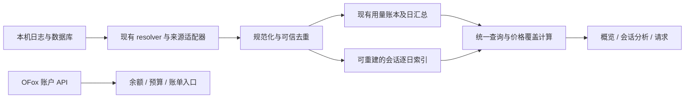

# OFox 用量分析设计与实施规划

状态：已确认，实施中。日期：2026-10-15。当前完成状态和验收边界见[实施记录](../../implementation-progress-2026-10-15.md)；本文仍是目标范围，不表示全部能力已交付。

本项目基线：`51d2268e`；参考 Magpie 源码：`bfaedf18`，本机应用：0.1.1231。本文依据当前代码和实际应用对比制定，不把设计目标记作已完成能力，不把 Magpie 的费用估算当作账单标准答案。

用户随后补充的可选工具安装与 MCP／Skills／共享指令资源库，见[独立扩展设计](2026-10-15-tool-catalog-and-library-design.md)。两份方案共同采用“工具／会话／资源库／用量”顶层导航；资源库管理不等于用量中的 Skills 调用归因，后者仍不属于首轮范围。

## 1. 目标与设计取舍

用量页应回答三个问题：最近用了多少、消耗集中在哪些项目和会话、哪些采集记录能够解释这些数字。现有余额、估价、缓存和排行是基础；本轮补上分析、追溯和完整性说明。

借鉴 Magpie 的信息组织：子页分工、共享筛选、六项会话 KPI、多指标趋势、点击排行深入查看。沿用 OFox 的工具绑定、账户余额、会话管理和主题组件，不照搬订阅账户池、本地网关或 Context 数据采集。

推荐决策：

1. 顶层导航采用“工具／会话／资源库／用量”；用量内增加“概览／会话分析／请求”三个子页。资源库与更多工具安装按独立扩展方案实施。
2. 初次访问进入概览，后续记住最后访问子页。默认 30 天；已有合法时间偏好继续生效。
3. 本机历史与当前 OFox 账户明确分开。工具解绑、账户切换不应让历史消失，也不能把无法归属账户的本地日志标成该账户账单。
4. 先解决统计覆盖、价格覆盖与时间口径，再增加图表。所有图表必须使用相同查询条件和统计版本。
5. 主数据库保持 schema v11。首期会话分析使用可重建的本机派生索引；源文件缺失导致无法重建的历史必须标记不完整。
6. 只读分析与会话管理分工。删除、恢复、永久删除、Markdown 导出、继续会话仍在现有顶层“会话”页。

## 2. 新增功能与优先级

### P0：数字可信，必须先完成

- 展示统计范围、最后成功同步时间、读取失败、历史缺口和价格目录更新时间。
- 用统一能力注册表取代手写 `unsupportedTools` 名单，补上 WorkBuddy 等遗漏；区分没有数据、不支持、读取失败和部分支持。
- 区分已知免费、未知价格、部分未计价和全量可估价。合计、趋势、排行、详情使用相同规则。
- 四类现有来源逐项对账：Claude、Codex、Gemini、OpenCode；验证累计值差分、子代理、归档与实时合并、文件搬迁和重复记录。
- 余额与本机估价分区说明；账户和区域切换时拒绝旧余额回复。

### P1：日常分析，首轮完整交付范围

- 三子页及共享时间、工具、模型、项目筛选；新增 90 天和自定义日期。
- 项目／模型／工具排行可点击筛选，提供条件摘要、重置和未知项目入口。
- 会话分析六项 KPI：会话数、Tokens、估算费用、缓存、活跃时长、项目数。
- 会话趋势：Tokens、输出 Tokens、消息、会话、费用、活跃。不可计算的指标显示原因，不伪造零值。
- Top 会话、只读详情和“在会话管理中打开”。
- 恢复请求列表、筛选、详情、分页与 CSV 导出；显示记录来源和指标测量样本数。
- 可见页自动刷新、手动刷新合并、更新提示；刷新保留焦点、滚动、菜单和详情。
- 增加有可信数据的本地来源：WorkBuddy、Hermes 优先，随后 Pi、dsh、OpenClaw；每个来源按实际能力上线。

### P2：在基础分析稳定后增加

- 活跃小时／星期热力图、长范围日历热力图。
- 会话长度与消耗分布；Top 会话按 Tokens、费用、活跃时长切换。
- 数据质量详情、按来源／模型／日期的对账导出。
- 估价来源与自定义价格管理的进一步整理；仅在能够解释和保存价格版本时增加历史价格视图。

### 本轮不纳入

Context 上下文组成／压缩分析、工具调用与 Skills 归因、多电脑合并、供应商订阅额度、账号池、网关配置、跨会话正文搜索。它们需要新的数据采集或产品边界，不能从现有 Tokens 推断。

## 3. 页面结构与交互

### 3.1 用量共用区域

```text
用量
概览 | 会话分析 | 请求
今天  7天  30天  90天  全部  自定义        更新于…  刷新周期  刷新
工具选择      模型选择      项目选择       当前条件 / 重置
统计范围及必要的数据完整性提示
当前子页内容
```

时间、工具、模型、项目共享于三子页。请求特有的来源、状态和搜索仅作用请求页，不暗中改变其他子页。排序、图表指标、打开的详情是各子页自己的状态。

工具选项来自实际历史记录和本机已发现能力，包含已解绑工具。当前绑定列表只用于提示“已绑定但不支持统计”，不裁掉历史。模型和项目菜单可搜索；项目显示目录短名，重名项目补父目录，完整路径通过详情／提示查看。“未知项目”是可选统计分组。

切换筛选后保留选中值，即使无结果也不退回“全部”。排行点击应用对应条件，再次点击已选项目清除该条件；面包屑和重置入口始终可见。若会话分析提供会话列表文本搜索，明确标为“搜索列表”，不改变上方统计。请求页搜索规则不同，见 3.4：该页摘要、列表和导出始终使用同一完整条件。

排行隐藏只影响呈现，不改变总量或查询集合；隐藏区明确说明并支持恢复。费用排序时，全部未知项放在已知项之后；部分未计价项按已知估价排序并带“+”标记。

### 3.2 概览：本机总量与账户余额

账户区保留现有 OFox 余额、余额趋势、预算及充值／账单入口，注明“当前账户”和更新时间。账户区不受工具、模型、项目筛选影响，余额变化也不等于本机估价总和。

本机区提供六格 KPI：Tokens、估算费用、缓存读取、采集记录数、会话数、项目数。消息／用量快照导入不一定等价于真实网络请求，因此不能把所有记录直接命名为 HTTP 请求。

趋势支持 Tokens、输出 Tokens、费用、采集记录数；排行按工具、模型、项目组织。没有会话／项目归属的记录进入“未关联会话／未知项目”，不为了榜单好看从合计中删除。

概览以全部已采集记录为范围；会话分析以可识别会话为范围。若两者不一致，给出未关联记录数和用量，支持跳转请求定位，不能默默强行让两个合计相等。

### 3.3 会话分析：对齐截图的核心体验

```text
会话数＋中位数/p90 | Tokens＋新输入/输出 | 估算费用＋价格覆盖
缓存读取＋命中率   | 活跃时长＋活动天数   | 项目数＋最多项目
每日趋势：Tokens / 输出 / 消息 / 会话 / 费用 / 活跃
项目排行                         模型排行
Top 会话：标题、项目、工具、模型、范围内用量、费用
```

六 KPI 对齐 Magpie 的问题组织。详情补缓存写入、消息数、来源和时间范围。中位数/p90 基于当前范围及筛选后的每个会话 Tokens，不能取会话终身总量。

Top 会话点击打开只读详情；会话管理跳转传递稳定键和定位信息，保留分析页筛选及滚动位置。没有原文件时仍可查看已知统计，说明“原始会话不可用”，不能显示可继续的假命令。首期不在分析页添加删除操作。

### 3.4 请求：恢复追溯能力

复用现有请求 API、查询、分页和详情逻辑，统一到当前主题，避免直接嵌回旧仪表盘整页。

- 筛选分为共享统计条件（工具、模型、项目、时间）与请求页专有条件（记录来源、状态、搜索）。请求页自己的摘要／趋势／列表／页数／CSV均应用两组条件，注明“当前请求条件”；专有条件不改变其他子页或账户余额。
- 来源标签区分会话日志导入和已有代理记录。只提供已有数据，不为此启用本地代理或采集新凭据。
- 核心列：时间、工具／模型、新输入／输出、估价、来源；状态和性能在有对应信息时显示。900px 保持主要列可读，其余放详情。
- 状态缺失的导入记录显示“未记录”；不把同步时写入的合成 200 当真实成功。
- 首 Token 时间、生成速度、失败率仅统计存在有效测量的样本，同时显示分母。没有首尾正文时间，不宣称实测输出速度。
- CSV 导出当前完整条件下仍可读取的全部明细，而非当前页；采用查询快照、流式分页及字段转义，防止单元格公式注入，不包含密钥或请求正文。导出前显示可导出记录数及覆盖日期，不能把 90 天范围内仅有汇总的部分合成为请求行；汇总导出使用独立、明确命名的入口。
- 30 天以前明细已归档时，说明“只有汇总”，不显示为“这段时间没有请求”。

后台刷新不重排用户正在阅读的旧页。首屏有新增记录时显示提示，由用户返回最新；打开详情、展开项、键盘焦点保持稳定。

## 4. 必须统一的统计口径

### 4.1 时间与 Tokens

- 新接口时间戳一律 epoch 毫秒；窗口采用 `[startMs, endMs)`。旧秒接口在适配层显式转换，不能改旧字段含义。
- 今天、7／30／90 天以本机时区自然日解释，包含今天；自定义结束日期包含当天，通过下一天零点形成排他上界。说明时区，覆盖夏令时与跨年。
- “全部”从最早可用记录到当前时间，并提示无法恢复的历史。跨度短用小时／日，长范围用周；更粗粒度必须在图表上注明。
- 主 Tokens 始终是新输入＋输出。缓存读取、缓存写入单列；可在详情显示“含缓存流量”，但不随子页改变主指标。
- 缓存命中率为 `cacheRead / (newInput + cacheRead + cacheWrite)`。分母为零时显示“—”，零读取但有提示词时显示 0%。
- 各来源由适配器规范化输入、缓存和 reasoning；字段语义未知时标记不支持，不能把缓存包含型输入再累加一遍。

### 4.2 会话、项目、消息和活跃

- 会话标识包含工具、逻辑数据源及原生会话 ID；不能仅按标题、项目路径或裸 ID 合并不同工具。
- 可信父子关系已解析时，子代理 Tokens 归属根会话及根项目，避免父子重复。无法确认时保留独立记录并提示，不能猜父子关系。
- 范围内有有效事件的会话计入会话数。日会话数逐日去重，其每日值之和可以大于区间唯一会话数。分位数仅使用范围内 Tokens 完整已知的会话，已知零值可以计入，未知或仅有下界的会话不按零混入；返回有效样本数及排除数，因此会话总数可以大于分位数样本数。中位数在偶数样本时取中间两值平均，p90 采用 nearest-rank（第 `ceil(0.9 × n)` 个升序样本），无有效样本显示“—”。
- 项目以规范化目录身份聚合；路径短名只用于展示。Windows 路径大小写／分隔符和自定义目录由现有 resolver 处理，未知路径保留分组。
- 消息数只计可识别的用户提问与助手回复；系统上下文、工具结果、thinking 不单独算消息。子代理不重复增加主会话消息数。
- 活跃时长参考 Magpie：相邻有效主会话消息间隔大于零且小于五分钟才计入，跨日区间按实际交集分摊。不是首末时间差，也不是人的工作时长。
- 多会话重叠的活跃时间会累加，说明这是“会话活跃累计”；不把它当墙钟工作时长。
- 选择模型后，会话数、Tokens、中位数/p90均基于该模型在窗口内的用量。无法归属模型的消息／活跃指标显示“—：不能按模型拆分”，禁用相应趋势，避免混合不同统计集合。
- 只有终身累计值而无时间分布的来源，不能填入 7／30 天趋势或伪造成一次请求；在来源详情展示累计值及范围限制。

### 4.3 费用与账户

推荐新分析页明确采用“按当前 OFox 价格估算”，展示目录更新时间、价格版本和可估价覆盖。四个 Token 桶分别计价，使用 Decimal，展示支持科学计数法和微小金额。

这是一种明确的新估价视图，不应静默改写已有历史金额。现有 `total_cost_usd` 作为“已保存金额”保留；现有维护已经可能按后来的价格重算该字段，原始价格时间／来源不一定可追溯，不能称为首次记录时金额。新返回值单独提供当前估价和价格策略，旧 `costUsd` 兼容语义保持。只有来源明确报告的金额才称工具自报成本；详情可比较已保存／工具自报金额与当前估价，两者不相加，也不能把差异直接解释为确定的历史价格变化。价格缺失时不能用余额差补齐。

界面规则：

- 已知价格且为零：`≈$0`。
- 全部未知：`—`，列出未计价模型。
- 部分未知：`≈$123+`，说明“部分用量未计价”，列出模型和已知记录数量。
- 历史数据只剩聚合且无法恢复当时价格覆盖：标记“历史计价状态未知”，不编造精确未计价调用次数。

模型有当前价格不代表历史每条记录当时都有价格；禁止用 `MAX(cost > 0)` 推断完整覆盖。对旧汇总可按模型 Token 桶重估；没有逐调用上下文阶梯／缓存 TTL 时明确使用基础价估算，不能声称账单级精度。

账户区使用当前组织余额与账单；本机记录不可靠包含 OFox 组织归属，首期不提供本机统计账户筛选。切账户只刷新账户区和相关价格上下文，不能重新归属本机历史。

## 5. 数据来源与能力设计

建立统一 `UsageSourceCapabilities`，供来源列表、同步、会话分析和提示使用。按来源声明：会话元数据、Token 桶、逐日用量、逐条记录、消息时间、模型归属、父子关系、HTTP 状态、性能测量；能力可为支持、部分支持、不支持。

注册身份复用已有稳定工具 ID，不能为新工具强制复用旧 provider/proxy 的 `AppType` 概念。数据库 `providerId` 与会话元数据中的工具/provider 身份必须经明确映射，不能同名即视为同一含义。

上线顺序：

1. 校准现有 Claude、Codex、Gemini、OpenCode；保留 Codex archive、Claude 子代理及 OpenCode SQLite／旧 JSON 已有支持。
2. WorkBuddy：优先评估 Magpie reader 对实际安装版的兼容，取得脱敏 fixture 后增加会话和逐条用量。当前 OFox 没有 reader，不假设改一行注册就可完成。
3. Hermes：复用现有会话发现和 SQLite 优先规则；累计模型用量与逐事件能力分开。只有累计值时，先上线累计信息与限制提示，不纳入精确按日统计。
4. Pi、dsh：复用现有目录、活动分支、generation、压缩及父子关系规则，按可验证字段开放能力。
5. OpenClaw：已有会话发现；验证记录格式和 usage 语义后接入。Cursor 等当前不属于 OFox 工具体系的来源另行规划，不顺带扩展产品。

每个来源回报 `lastAttemptAt`、`lastSuccessAt`、扫描／导入／跳过数量、覆盖时间、能力与脱敏错误。一个来源失败不阻止其余来源；保留最后成功数据并标部分结果。无权限、损坏、无文件、不支持版本是不同状态。

本机索引仅保存统计事实与定位元数据，默认不保存正文、密钥、HTTP header 或额外凭据。

## 6. 后端架构与历史策略



### 6.1 复用及边界

复用 `usage_sync` 的单次在途锁、现有 parser、增量差分和 session usage 批量 SQL；复用旧请求查询与详情。增强 `usage_overview` 过滤和返回信息，新增会话分析查询，不在前端逐条读取 600 个会话后拼统计。

原用量账本负责请求／导入记录和历史总量；会话索引负责项目、逐日消息、活跃、根会话关系及会话粒度分布。两者提供查询快照及覆盖说明，不能把重扫 transcript 的用量再追加到已有账本。

两条统计路径均经过同一规范化与可信去重层。同源重扫／修订／搬迁替换已有贡献，覆盖压缩与未压缩副本、SQLite 与旧 JSON、generation 及继承 seed；逻辑来源身份不等于物理文件路径。不同来源不能仅凭裸会话 ID 合并。

同一事件存在代理记录和日志导入时，只有可信原生 request/response ID 等关联可以合并。无法关联的来源不能凭时间近似去重；查询需返回可能重叠的来源提示，不宣称精确总量。实现前先审计四源现有去重策略。

### 6.2 保持 schema v11 的首期方案

会话按日事实是机器本地派生数据，复用 `session_meta_cache` 的版本化 `meta_json` envelope：元数据与 analytics 子结构由同一个缓存协调器写入，analytics 有独立版本、源 stamp、时区及计算规则版本。

当前缓存会整行替换 JSON、删除不在扫描列表的行，且只缓存部分工具。不能直接加字段就交给旧 writer：先统一缓存入口，覆盖新来源，确保元数据更新不擦掉 analytics，完整扫描与 UI 筛选／分页分离。此处需要回归测试后再接分析页。

文件来源按物理文件保存 envelope；SQLite 来源按数据库保存一个完整来源快照，内部再按工具／逻辑来源／会话键区分会话，不能让多个会话覆盖同一 `source_path` 行。SQLite 变更检查包括主库与 WAL revision，以及同一只读连接上的 `data_version`；连接重建、checkpoint、数据库替换均使旧快照失效，不对用户数据库执行 checkpoint 或写入。

修改／新增日志按源 stamp 增量解析；同源修订替换事实，而非加一次总量。价格变化只重估数字，不重读正文。时区改变使可重建的日期分桶缓存失效，但原始事件时间不被重写。旧 `usage_daily_rollups` 只有归档时本地日期，没有原始时间戳或时区，不能精确重分日：保留旧归档日期，返回 `legacyLocalDate` 时间依据及受限覆盖；换时区后的边界和日序列不得冒充同一精度。

源文件缺失／回收时，缓存标记缺失／回收状态并保留已知事实，不因当前管理列表看不到而立即删除；只有明确缓存清理才允许丢弃可重建部分。该保留仍不是永久账本保证。

### 6.3 必须诚实呈现的历史限制

现有请求明细保留 30 天；`usage_daily_rollups` 没有项目／会话逐日维度，`session_usage_archive` 只有会话／模型累计及首末时间。不能从这些字段恢复历史逐日消息、活跃或项目日分布。

- 原始日志仍在：重建对应范围的会话索引，返回已扫描范围。
- 原始日志缺失：保留账本总量，分析指标返回 partial／unknown，说明“部分历史无法按项目或会话拆分”。不能平均分配总量到日期。
- 源文件放入回收站：保留当前派生索引，停止从该文件继续增量读取；恢复后按源身份关联。不能把会话管理软删除当撤销消费。
- 缓存损坏或清除且原始日志已失：主账本总量仍在，但分析粒度可能无法重建。这是首期明确限制，不称永久完整历史。

如果后续要求“原始文件删除、清缓存后仍永久保留精确项目／会话逐日历史”，就必须把逐日事实升级为持久账本，并增加正式 migration、归档事务、备份／恢复／WebDAV 语义及退出策略。该需求有必要改变 schema，应单独立项；不能藏一个不可重建的 sidecar 数据库来规避版本管理。

## 7. 查询、接口与状态

设计中的查询对象使用 camelCase：`startMs`、`endMs`、`toolIds`、`modelIds`、`projectIds`、`sourceIds`、`granularity`。请求页再加状态、搜索和分页。身份字段由后端生成稳定键，项目路径不是写入指令。

概览和会话分析响应一次返回 KPI、序列、排行、Top、可用筛选项及以下元信息：

- `queryFingerprint`／`snapshotVersion`：保证所有区块属于同一条件及数据版本。
- `coverage`：来源、时间范围、不可拆分历史、未关联会话、指标可用性；各指标可以有不同完整性。
- `pricingCoverage`：价格策略及版本、已知免费／未知模型、可确定的未计价记录数量；无法确定的数值为 null。
- `lastSuccessAt`／`sources`：逐源同步信息；不以一次部分失败运行的结束时间冒充完整数据更新时间。

接口演进原则：

1. 保留 `get_usage_overview(period)` 旧调用；新增可选查询参数和兼容字段。已有缓存期限不视为刷新周期。
2. 新增批量 `get_session_usage_analytics(query)`，独立于正文读取及列表分页。
3. 复用 `get_request_logs`／`get_request_detail`，新增可选过滤，旧秒参数通过适配层处理；CSV 后端按同一快照导出。
4. 新增能力／健康信息查询，复用 `usage-synced` 并补来源版本。实际接口命名在实施时统一，不重复提供同义命令。
5. 老后端缺能力时保留原概览并说明限制；有项目筛选但后端不支持时禁用并解释，不能静默返回全量数据。

本机统计 cache key 包含查询条件、来源版本、时区与价格策略版本；账户区另按账户／组织／apex 分键。查询切换及卸载后拒绝过期结果。快速连续筛选可以短暂合并请求，KPI／图表不得先显示新条件标题再挂旧条件数字。

## 8. 刷新与性能

刷新周期提供关、5、10、30、60 秒，推荐默认 30 秒。只在用量页及当前子页可见时触发，窗口隐藏、最小化及切页后停轮询；判断实际窗口状态，不只依赖组件仍挂载。

刷新一次只进入一个协调任务：目录轻量检测→变更文件增量解析→生成快照→更新视图。手动刷新在已有任务运行时合并为最多一次后续任务。自动刷新不要绕过后端 60 秒防抖却显示“5 秒同步”：复用单次在途锁，按变更驱动增量采集；无变更的 tick 不全量扫描／解析。后台十分钟调度继续作为兜底。

余额联网有独立限频和手动刷新语义，不随每次本机图表 tick 重复请求；更新说明分别展示本机同步与账户余额时间。

性能验收采用脱敏 fixture 和可复现计数：

- 600+ 会话由批量聚合取得，不发生逐会话 IPC／SQL 的 N+1。
- 同一 stamp 缓存命中不再解析正文；切指标、排序、筛选不触发源文件重扫。
- 10k 会话元数据、50k 请求记录用分页／虚拟化和后端过滤，不把全部正文传至前端。
- 冷启动允许分阶段扫描并保留进度；热查询目标在开发参考设备 p95 < 300ms，UI 筛选更新目标 < 500ms，实测记录设备和规模后再定发布门槛。

## 9. 视觉、布局与无障碍

参考 Magpie 的六格 KPI、大趋势图、并列排行和较低视觉噪声，使用 OFox 现有橙色强调、主题 token、字体和组件，不复制 Magpie 紫色或品牌结构。

- 900px 下六 KPI 为三列两行；筛选可换行。排行两栏但每栏只保留名称、条形和主要值，次要数字放详情；确实放不下时切单栏，禁止压缩到难以辨认。
- 趋势图高度约 180–220px，提供数值刻度、峰值、日期、单位和图例；补精确 tooltip，键盘可查看同样信息。
- 更窄窗口 KPI 两列、排行单列。请求详情用 Dialog，宽窗口可用侧面板；整页不横向溢出。
- 长路径与模型名可截断，完整值可访问；数字和单位不任意折行。未知费用使用中性色，不用绿色暗示已确认。
- 复用 ListCard、SegmentedControl、MenuSelect、ShareBar、Dialog 等组件。图表组件按所需刻度／键盘能力扩展，不直接沿用固定 72px 迷你图作为主分析图。
- 子页按 tablist 键盘行为；菜单↑↓／Home／End／Enter／Escape、初始选中、Tab／Shift+Tab稳定。关闭详情恢复触发项焦点，刷新不重置焦点。
- 图表提供可访问数据摘要／数据表，不能只靠颜色和 hover。
- 文案覆盖 zh/en/ja，key／占位符集合一致；OFox 外链由统一 apex 构造器生成。浅色、深色、900px 和原生窗口分别验收。

## 10. 实施顺序与可验收交付

每阶段先建立失败测试，再实现、独立评审、修复与复审。用户已授权 subagent 加速，当前按文件边界使用独立工作区并行实施，集成前交叉独立评审；Rust 构建仍串行复用缓存。只 commit，不 push、不改版本、不打标签。实际进度及尚未验收的边界见[实施记录](../../implementation-progress-2026-10-15.md)。

### 阶段 A：口径与可信度

完成来源能力注册表、WorkBuddy 提示遗漏、时间范围规范、价格覆盖、当前估价视图、同步健康和账户区隔离。四源对账 fixture 先于图表扩展。

验收：已知免费／全未知／部分未知／科学计数金额；缓存口径；来源失败保留成功数据；不同账户旧请求；两个 apex；30 天本地自然日；archive＋live无重复。对实测差额按源／模型／日期输出可解释分类，不能以总量“看起来接近”通过。

### 阶段 B：工作台与请求恢复

完成三子页、时间／工具／模型共享筛选、90 天／自定义、概览趋势切换、请求分页／详情／CSV、可见页自动刷新。项目筛选与排行在阶段 C 接通前禁用并说明尚不可用；来源没有项目解析能力也不能改归“未知项目”，只有解析后确实没有目录的记录才进入该分组。会话分析先有可用数据再显示，不交付伪造 KPI。

验收：同条件一致、老后端降级、请求字段未知、全页导出、重复刷新合并、窗口隐藏停止轮询、焦点／页码／详情保留；请求搜索／状态／来源变化时摘要、分页、导出一致；90 天包含归档区间时导出行数和覆盖说明一致，不生成假明细。

### 阶段 C：会话与项目分析

统一 metadata／analytics 缓存协调，增加按日索引、父子归属、项目筛选和排行、六会话 KPI、多指标趋势、Top 及跳转会话管理。来源可用性逐指标声明。

验收：600+ 会话单批聚合、缓存不重复解析；SQLite WAL-only 写入可更新、同库多会话不覆盖；同名不同目录项目；跨午夜、夏令时及换时区；模型筛选中位数/p90与有效样本一致；未知消息／活跃不造零；子代理不重复；30 天归档后缺源返回 partial；回收／恢复不造成消费重复；不可解析项目与真实未知项目分开声明，项目筛选不静默掩盖无法归属的总量。

### 阶段 D：新增来源

顺序为 WorkBuddy→Hermes→Pi／dsh→OpenClaw。逐来源提交与评审，不为快速覆盖复制解析代码或全工具统一猜字段。累计来源只开放能证明的指标。

验收：安装版与脱敏原生 fixture 对照；目录 resolver、文件移动／修订、generation、父子关系、零值与缺字段、旧版本损坏。macOS 与 Windows 结果分开记录，Windows 未跑不能称跨平台通过。

### 核心交付门禁：阶段 A–D 完成后

阶段 A–D 是首轮完整交付，不等待 P2。最终提交运行前端 typecheck／format／全量单测、Rust fmt／all-targets clippy／全量测试，再完成原生 UI 行为验收与同 SHA Windows 验证。

### 阶段 E：独立的高级分析迭代

核心交付后增加热力图、分布和数据质量导出；按其改动重新执行评审、最终门禁与平台验收，不把阶段 A–D 的旧测试结果当作新版本结果。

任何阶段阻塞时保留可用结果并记录限制，不将能力受限显示为“全部完成”。测试使用沙箱及共享 serial 锁，不修改真实 settings 或制造真实数据损坏。

## 11. 主要风险与处置

- **来源覆盖不同导致差额**：展示来源覆盖，逐事件对账；Magpie 仅是参考，不能靠修改公式把总数凑齐。
- **旧历史无法按项目拆分**：保留总量、声明 partial；永久逐日历史需要独立持久化设计。
- **累计值没有真实日期**：展示累计与限制，不写入假请求，不放入最后活动日。
- **价格重估造成用户误解**：独立估价字段、版本和明确文案，保留记录金额，不混同账单。
- **重复来源／子代理计数**：可信身份去重、根会话归属和可解释来源，不能只按时间近似合并。
- **高频刷新耗资源**：只有可见页增量检查，协调任务合并，余额限频，记录实际同步时间。
- **缓存 writer 相互覆盖**：统一 envelope 与写入者，完整扫描独立于 UI，版本化和损坏降级。

## 12. 代码依据

OFox 当前实现与可复用入口：

- [用量页](../../../src/components/usage-overview/UsagePage.tsx)、[查询与刷新](../../../src/hooks/useUsageOverview.ts)、[API 数据结构](../../../src/lib/api/usageOverview.ts)。
- [旧请求仪表盘](../../../src/components/usage/UsageDashboard.tsx)、[请求列表](../../../src/components/usage/RequestLogTable.tsx)、[请求接口](../../../src/lib/api/usage.ts)、[请求统计](../../../src-tauri/src/services/usage_stats.rs)。
- [同步来源与调度](../../../src-tauri/src/services/usage_sync.rs)、[用量概览](../../../src-tauri/src/services/usage_overview.rs)、[会话用量批量查询](../../../src-tauri/src/session_manager/usage.rs)、[历史金额维护](../../../src-tauri/src/services/usage_maintenance.rs)。
- [会话元数据缓存](../../../src-tauri/src/session_manager/meta_cache.rs)、[归档与保留](../../../src-tauri/src/database/dao/usage_rollup.rs)、[schema v11](../../../src-tauri/src/database/schema.rs)。
- [会话管理 API](../../../src/lib/api/sessions.ts)、[会话管理页面](../../../src/components/sessions/SessionsPage.tsx)、[工具接线](../../agent-wiring.md)。
- [开发规范](../../code-standards.md)、[已接受限制](../../known-limitations.md)、[Windows 验证](../../windows-testing.md)。

Magpie 参考基线对应源码，路径为其仓库内相对路径：

- `internal/gui/assets/app.js`：`USAGE_TABS`、`SESS_RANGES`、`SESS_METRICS`、`renderSessions`、`renderSessChart`，见约 18169／18718／18802／18915 行。
- `internal/sessions/stats.go`：范围统计、Overview、筛选及项目归属。
- `internal/sessions/sessions.go`：来源发现及活跃时间。
- `internal/sessions/calls.go`：请求提取、来源能力及记录时间。
- `internal/usage/ledger.go`：请求筛选、范围、指标和导出。
- `internal/catalog/catalog.go`：价格策略；Magpie 的价格与 OFox 价格不能混为同一账单标准。

后续实施应更新本文状态及验收记录，并同步实际接口说明；不得把设计中的能力提前写进现有实现文档。

## 13. 设计复核记录

2026-10-15：产品交互与后端统计／缓存两路独立复核及修订后复审通过。修订明确了项目能力缺失、请求搜索与导出范围、核心／高级交付门禁、未知分位数样本、SQLite WAL 变更、重复来源、旧历史金额及换时区归档的边界。

以上为初始设计复核记录，不代表功能验收。当前实施已启动；已完成切片与测试证据以[实施记录](../../implementation-progress-2026-10-15.md)为准，行为与平台验收仍按各阶段分别记录。
